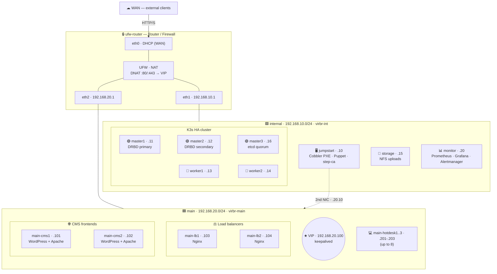

# CMS High-Availability Infrastructure — Fully Automated Deployment

<div align="center">

[](docs/SOFTWARE_BASELINE.md)
[]()
[](cmd/cms-ha/)
[](ansible/)
[](.github/workflows/ci.yml)
[](LICENSE)

**Zero-touch infrastructure for a high-availability Content Management System.**<br/>
*16 VMs · 2 segmented networks · 14 deployment steps · single Go binary · idempotent*

</div>

---

## Overview

This project implements the **complete design, provisioning, and automation** of an enterprise-grade high-availability IT infrastructure running a WordPress CMS — from bare-metal OS installation to full-stack observability.

The environment is deployed with a **single command** (`cms-ha deploy`): 16 virtual machines, 2 isolated network segments and 14 pipeline steps, with no manual intervention.

### Orchestration Engine

The environment is driven by three cooperating layers:

- **`cms-ha` (Go CLI orchestrator)** — the supported entry point: a statically compiled binary with an integrated SSH connection pool, bounded worker semaphore concurrency, type-safe YAML configuration, `age`-based secret encryption, structured logging (`slog`), self-healing routines, phase checkpoints (`--resume` / `--from-phase`) and parallel health verification.
- **Ansible** (`ansible/`, optional) — declarative *creation* of the libvirt networks and VM domains from `config.yaml`; the default, gate-validated creation path remains `cms-ha deploy`.
- **Puppet** (`puppet/`) — node *desired state* (packages, services, exporters, `/etc/hosts`, …).

> The legacy v1 shell suite has been removed; see `docs/LEGACY-V1-MAPPING.md` for the v1 → v2 command mapping.

### Key Technical Highlights

| Area | Implementation |
|:-----|:---------------|
| **Zero-touch Provisioning** | Cobbler PXE server + Ubuntu autoinstall for unattended OS deployment |
| **Idempotent Configuration** | Puppet 8 agent/server model with role-based manifests & auto SSL self-healing |
| **HA Clustering** | K3s (lightweight Kubernetes) with 3 server nodes (embedded etcd, tolerates 1 failure) + 2 agent nodes |
| **Synchronous Block Replication** | DRBD 9 Protocol C between master nodes for zero data loss with dynamic node affinity |
| **Automated Failover** | Autonomous DRBD watchdog daemon (`drbd-failover-watchdog.service`) + gateway quorum verification + Kubernetes pod migration + chaos testing suite |
| **Load Balancing** | Nginx reverse proxy with health checks across 2 WordPress/Apache frontends |
| **Full-stack Observability** | Prometheus + Grafana with 19 alert rules (DRBD/etcd quorum, keepalived VIP, service & backup health), dynamic scrape targets and dashboards whose every panel query is checked against Prometheus |
| **Defense in Depth** | UFW perimeter firewall + dynamic WAN MAC detection + per-node iptables rules + network segmentation |
| **Internal PKI** | Private Certificate Authority (step-ca) with automated TLS trust distribution |
| **Infrastructure as Code (optional)** | Ansible (`community.libvirt`) declares networks, disks and VM domains; the Go `init-vms` phase is the default/gate path |
| **Automated Backups** | Daily dump + off-DRBD upload to a Garage S3 store (container on the hypervisor), automated restore drill, `BackupMissing` alert |
| **Secret Hardening** | `age` (X25519) auto-encryption of `config.yaml` secrets on first load (key kept at `~/.config/cms-ha/`, never committed); K3s join token distributed as a `0600` file — never in argv; database/WordPress/CA credentials supplied in `config.yaml` |
| **Access Hardening** | Non-root deploy account (`ssh.user`) with transparent `sudo -n`; direct root SSH disabled (`PermitRootLogin no`) on every node; SSH host keys pinned on first use (TOFU, fail-closed on mismatch) — see `docs/SECURITY.md` |
| **Strict Failure Semantics** | Every remote command's exit code is verified per phase; broken DRBD/K3s state aborts the deploy instead of reporting silent success; failover tests validate shutdown and report un-runnable scenarios as `SKIP` |
| **CI/CD Pipeline** | GitHub Actions: Go test (-race), ShellCheck, yamllint, kubeconform, puppet-lint, ansible-lint, and a security job (`gosec` + `govulncheck` + `Trivy`) |

> **Verified end to end** — the full lab has been deployed and validated on KVM: PXE provisioning, parallel Puppet convergence, the K3s HA cluster, HTTPS through the VIP, DRBD replication, UFW NAT and Prometheus metrics (`cms-ha verify` green).

---

## Architecture

The network is segmented into **two isolated subnets** connected by a UFW router/firewall:

| Network | CIDR | Bridge | Purpose |
|:--------|:-----|:-------|:--------|
| **internal** | `192.168.10.0/24` | `virbr-int` | K3s cluster, MariaDB, DRBD replication, monitoring, provisioning |
| **main** | `192.168.20.0/24` | `virbr-main` | Load balancer, CMS frontends (WordPress), hot-desk workstations |

`jumpstart` belongs to **`internal`** (`192.168.10.10` — it is the PXE/DHCP/DNS/Puppet/CA server for that subnet) and is dual-homed with a second interface on **`main`** (`192.168.20.10`). The diagram below shows the topology; the service flows between nodes are in [`docs/NETWORK_DIAGRAM.md`](docs/NETWORK_DIAGRAM.md).



> For detailed topology, service, and deployment sequence diagrams see [`docs/NETWORK_DIAGRAM.md`](docs/NETWORK_DIAGRAM.md).

---

## Technology Stack

| Component | Technology | Version | Purpose |
|:----------|:-----------|:--------|:--------|
| Operating System | Ubuntu Server | 24.04 LTS | Base OS for all nodes |
| Bare-metal Provisioning | Cobbler | 3.3.x | PXE + autoinstall for unattended deployment |
| Configuration Management | Puppet | 8.x | Declarative, agent-based configuration |
| Container Orchestration | K3s | v1.29.x | Lightweight Kubernetes for HA clustering |
| Database | MariaDB | 10.11.x | StatefulSet inside K3s cluster |
| CMS | WordPress | 6.x | Content Management System |
| Web Server | Apache | 2.4.x | CMS frontend server with PHP 8.3 |
| Load Balancer | Nginx | 1.24.x | Reverse proxy with upstream health checks |
| Block Replication | DRBD | 9.x | Synchronous Protocol C replication |
| Metrics Collection | Prometheus | 2.x | Time-series monitoring with exporters |
| Alerting | Prometheus alert rules (19) + Alertmanager | 2.x / 0.23 | Availability, DRBD/etcd quorum, keepalived, service & backup health; routed and deduplicated by Alertmanager |
| Dashboards | Grafana | 13.2.4 | Metrics visualisation and dashboards |
| Firewall | UFW | — | Perimeter and per-node iptables rules |
| PKI / TLS | step-ca | 0.27.x | Internal Certificate Authority |
| Infrastructure Provisioning (optional) | Ansible + community.libvirt | 2.16 | Optional declarative network/VM creation; default is Go `init-vms` |
| Virtualisation | KVM / QEMU / libvirt | — | Hypervisor and VM management |

> Full software inventory with versions, dependencies, and download URLs: [`docs/SOFTWARE_BASELINE.md`](docs/SOFTWARE_BASELINE.md)

---

## Repository Structure

```
CMS-HA-Infrastructure/
├── README.md                        # This file
├── Makefile                         # Build, deploy, lint, and ops targets
├── config.yaml                      # Centralised typed configuration (age-encrypted secrets)
├── go.mod / go.sum                  # Go module definition
├── embed.go                         # Embeds templates/, kubernetes/ and Grafana dashboards
│
├── cmd/cms-ha/                      # CLI entry point (Cobra)
│   ├── main.go                      # Binary entry point
│   └── root/                        # Command definitions
│       ├── root.go                  # Root command + global flags (--config, --verbose, --dry-run)
│       ├── phase.go                 # cms-ha phase <name>  (all 13 phase subcommands)
│       ├── deploy.go                # cms-ha deploy        (full orchestration)
│       ├── vm.go                    # cms-ha vm <action>   (start, stop, shrink, fix-boot-order, ...)
│       ├── cleanup.go               # cms-ha cleanup       (destroy all VMs, disks, and networks)
│       ├── verify.go                # cms-ha verify        (health check)
│       ├── test.go                  # cms-ha test failover (chaos engineering)
│       ├── traffic.go               # cms-ha traffic       (k6 load test)
│       ├── repair.go                # cms-ha repair k8s|clocks
│       ├── secrets.go               # cms-ha secrets encrypt|decrypt|generate-key|rotate
│       └── ...                      # backup, status, lint
│
├── internal/                        # Core Go packages (not importable externally)
│   ├── config/                      # Typed YAML config loader (yaml.v3) + age encryption
│   ├── ssh/                         # SSH connection pool + SFTP + parallel execution
│   ├── libvirt/                     # virsh/virt-install/qemu-img wrapper
│   ├── logging/                     # Coloured structured logging (slog + fatih/color)
│   ├── retry/                       # Retry/poll primitives with context
│   ├── deploy/                      # Orchestrator — coordinates all phases
│   ├── lint/                        # External linter runner (shellcheck, yamllint, ...)
│   ├── utils/                       # VM ops, verify, failover, repair, status
│   └── phases/                      # Phase implementations (one package per phase)
│       ├── initvms/                 # 00 — VM creation (libvirt/cloud-init/PXE)
│       ├── cobbler/                 # 01 — Cobbler PXE server setup
│       ├── registernodes/           # 02 — Register nodes in Cobbler
│       ├── repairssh/               # 03 — SSH + Puppet CA repair
│       ├── puppet/                  # 04 — Puppet Server/Agent deployment
│       ├── drbd/                    # 05 — DRBD block replication
│       ├── kubernetes/              # 06 — K3s HA cluster + MariaDB
│       ├── nginx/                   # 07 — Nginx LB + WordPress frontends
│       ├── monitoring/              # 08 — Prometheus + Grafana
│       ├── ufw/                     # 09 — UFW perimeter firewall
│       ├── pki/                     # 10 — Internal CA (step-ca)
│       └── traffic/                 # 11 — k6 load generator (pinned grafana/k6 container)
│
├── kubernetes/                      # K3s manifests — Kustomize tree (base/ + monitoring/ + overlays/ + backups/ + jobs/)
├── puppet/                          # Puppet manifests and modules (role-based)
├── templates/                       # Configuration templates (Go text/template)
├── ansible/                         # Infra as code: libvirt networks + VM domains (create/declare)
├── tests/integration/run.sh         # End-to-end integration driver (deploy + verify + failover)
├── docs/SECURITY.md                 # Non-root access, host-key TOFU, CI scanning model
├── docs/LEGACY-V1-MAPPING.md        # v1 shell scripts → v2 commands (legacy scripts removed)
├── .github/workflows/ci.yml         # CI: build/tests + lint + kustomize/kubeconform + ansible-lint + security scan
├── .github/workflows/integration.yml # CI: end-to-end lab run on a self-hosted KVM runner
└── .github/workflows/integration-hosted.yml # CI: the same lab on a GitHub-hosted runner
```

---

## Quick Start

### Prerequisites

- Linux host (AMD64) with **KVM/QEMU** and **libvirt** installed
- **Go 1.26+** (for building from source) or download the pre-built binary
- At least **16 GB RAM** (27 GB recommended for full deployment)
- Ubuntu 24.04 Server ISO
- SSH key pair for cluster management

### Build

```bash
git clone https://github.com/Aitor42/CMS-HA-Infrastructure.git
cd CMS-HA-Infrastructure

# Build the CLI binary
make build

# Or directly with Go
go build -o cms-ha ./cmd/cms-ha/
```

### Deployment

```bash
# Edit config.yaml to match your environment
vim config.yaml

# Set database passwords and wordpress.admin_password in config.yaml as plain text.
# The first cms-ha operation that loads the config encrypts non-empty secrets automatically.
# The configuration (CIDRs, node IPs/MACs/FQDNs, hotdesk bounds, HA quorum) is validated on every run.
./cms-ha deploy

# Preview all 14 pipeline steps without executing anything (--dry-run only works in deploy)
./cms-ha deploy --dry-run

# Or resume with pre-installed VMs
./cms-ha deploy --skip-vm-create

# Run a specific phase
./cms-ha phase setup-drbd

# Verbose output
./cms-ha -v deploy
```

The orchestrator executes all phases sequentially: VM Init (jumpstart) → Cobbler → Register Nodes → VM Init (clients) → Repair SSH → Router Gateway (addresses, forwarding, NAT) → Puppet → DRBD → Garage Backups → K3s → Nginx & WordPress → Monitoring → UFW → Internal CA (14 pipeline steps, from 13 distinct phases; `--skip-vm-create` drops the two VM Init steps for a 12-step run).

### Optional: provisioning with Ansible (Infrastructure as Code)

The default and PXE/Cobbler-gated path is `cms-ha deploy` (Go `init-vms`).
Ansible is an optional declarative alternative generated from `config.yaml`
(the single source of truth) and is linted/parity-tested, but it is not the
gate-validated path:

```bash
# Generate the inventory from config.yaml
./cms-ha inventory

# Create networks + disks + domains (idempotent)
make provision            # or: cd ansible && ansible-playbook playbooks/provision.yml
make provision-check      # dry run

# Then run the service phases (Cobbler, Puppet, K3s, ...)
./cms-ha deploy --skip-vm-create
```

Ansible only *creates and declares* infrastructure. Runtime operations
(start/stop/shrink) and fencing stay on the thin `libvirt`/`virsh` primitive in
the Go CLI — see [`ansible/README.md`](ansible/README.md) for the boundary.

Both paths create the same domains from `config.yaml`; the Go `init-vms` phase
is the supported default.

---

## Deployment Phases

Each phase is invoked through the unified Go CLI (`cms-ha`). The numbers follow the project milestones in `docs/phases/`; the rows are listed in deployment order.

| Phase | Command | Target Nodes | Description |
|:-----:|:--------|:-------------|:------------|
| **00** | `cms-ha phase init-vms` | Hypervisor (16 VMs) | Virtual networks and VM domain creation via libvirt/KVM |
| **01** | `cms-ha phase setup-cobbler` | `jumpstart` | Cobbler PXE server, DHCP, TFTP, DNS (BIND9) & NFS |
| **02** | `cms-ha phase register-nodes` | `jumpstart` | Host profile definitions, static IPs and MAC bindings |
| **03** | `cms-ha phase repair-ssh` | All client nodes | Post-install SSH key synchronization & Puppet CA reset |
| **03.5** | `cms-ha phase bootstrap-router` | `ufw-router` | Router gateway bring-up: static gateway addresses, IP forwarding and NAT (checked with a real download before Puppet needs one) |
| **04** | `cms-ha phase setup-puppet` | `jumpstart` + all clients | Bounded parallel Puppet catalog execution with SSL healing |
| **05** | `cms-ha phase setup-drbd` | `internal-master1/2` | DRBD 9 synchronous block replication (Protocol C) |
| **05.5** | `cms-ha phase setup-backup` | Hypervisor | Garage S3 store for the nightly database dumps |
| **06** | `cms-ha phase setup-kubernetes` | Masters + Workers | K3s HA cluster, DRBD node affinity labeling & MariaDB |
| **07** | `cms-ha phase setup-nginx-wordpress` | `main-lb1/2`, `main-cms1/2` | Nginx reverse proxy (+ keepalived VIP) & WordPress/Apache frontends |
| **08** | `cms-ha phase setup-monitoring` | `internal-monitor` + all | Prometheus, Grafana, alert rules, blackbox probes & node exporters |
| **09** | `cms-ha phase setup-ufw` | `ufw-router` + all nodes | Perimeter routing, dynamic WAN NAT & per-node UFW |
| **10** | `cms-ha phase setup-ca` | `jumpstart` + all nodes | Smallstep PKI (step-ca) & cluster-wide TLS trust |
| **—** | `cms-ha traffic` | Workstations & LB | Post-deploy k6 load/smoke profile (RPS, p95/p99, error rate); every Grafana panel query is then checked for data |

---

## Orchestrator Design

The Go orchestrator keeps the pipeline fast and safe:

- **SSH connection pool** (`internal/ssh`) — one authenticated client per IP, safe for concurrent use, with in-memory SFTP uploads.
- **Bounded parallelism** — clients converge in parallel (window from `deploy.puppet_concurrency`, auto 4–8 by CPU count) after the jumpstart node, so Puppet Server, DNS and Cobbler are up first. The CMS frontends converge sequentially because the first one creates the WordPress schema.
- **Fast jumpstart (hosted workflow default)** — `phase init-vms --jumpstart-image cloud` boots a qcow2 overlay of the Ubuntu cloud image for iteration and CI. The CLI/config default remains ISO/PXE, and the ISO/PXE path remains the deliverable gate; the hosted workflow defaults to cloud because it is the fastest way to exercise the rest of the pipeline.
- **Fast provisioning (hosted workflow default)** — `deploy --fast-provisioning` (or `vm.provisioning: cloud`) installs the jumpstart and every client node from the same cloud image, with per-node cloud-init for hostname, MACs, static addresses and SSH key. The CLI/config default remains PXE; the hosted workflow defaults to `fast_provisioning=true` for speed. The PXE/Cobbler run remains the deliverable gate (self-hosted `integration.yml`, or a hosted dispatch with `jumpstart_image=iso` and `fast_provisioning=false`).
- **Self-healing** — stale Puppet certificates are revoked, re-signed and the catalog is re-run; broken DRBD/K3s state aborts the deploy instead of reporting success.
- **Secrets** — service passwords are age-encrypted on first load; the key lives in `~/.config/cms-ha/age.key`, outside the repository. `cms-ha secrets rotate` rekeys the config and keeps timestamped backups; `gitleaks` scans the tree in CI.
- **Checkpoints** — `deploy.state` lets `--resume` and `--from-phase` continue after a failure. A `deploy.state.lock` file makes a second concurrent deploy fail fast instead of corrupting the checkpoint.

---

## Operations & Verification Reference

### Full Infrastructure Health Check

Run the comprehensive, parallel health verifier:

```bash
# Supported: runs 10 checks in parallel; the end-to-end check adds a short
# request burst through the load-balancer VIP and functional checks of the CMS
# features, the database round-trip and the monitoring probes, so the run takes
# seconds
./cms-ha verify
```

Example output from a fully converged environment:

```text
ℹ Starting phase: Infrastructure Verification
✓ Phase 00 - Libvirt VMs & Networks: [PASS] (16 running VMs)
✓ Phase 01 - Cobbler Services & Systems: [PASS] (Systems: 15)
✓ Phase 02 - Puppet Server & Certs: [PASS] (Certs: 15)
✓ Phase 03 - Nginx & Apache & SSL: [PASS]
✓ Phase 04 - K3s & MariaDB Pod: [PASS]
✓ Phase 05 - Prometheus & Grafana: [PASS]
✓ Phase 06 - Router UFW & IP Forward: [PASS]
✓ Phase 07 - DRBD Status: [PASS] (Verified on 192.168.10.11)
✓ Phase 08 - End-to-end HTTP (CMS, Grafana, Prometheus): [PASS] (CMS: 100/100 requests OK (100%), Prometheus: healthy, 9 target(s) up, Grafana: database ok (v13.2.4))
✓ Phase 10 - Stack functional checks (CMS pages, REST API, frontends, load balancers, MariaDB, backup store, probes, Grafana): [PASS]
✓ Completed phase: Infrastructure Verification in 21.37s
```

### SSH Connectivity Matrix

```bash
./cms-ha status ssh              # one probe per node
./cms-ha status ssh --wait 10m   # wait until every node accepts SSH, then print
```

```text
VM NAME              IP              STATE      SSH       
------------------------------------------------------------
ufw-router           192.168.10.1    running    OK        
jumpstart            192.168.10.10   running    OK        
internal-master1     192.168.10.11   running    OK        
internal-master2     192.168.10.12   running    OK        
internal-master3     192.168.10.16   running    OK        
internal-worker1     192.168.10.13   running    OK        
internal-worker2     192.168.10.14   running    OK        
internal-storage     192.168.10.15   running    OK        
internal-monitor     192.168.10.20   running    OK        
main-lb1             192.168.20.103  running    OK        
main-lb2             192.168.20.104  running    OK        
main-cms1            192.168.20.101  running    OK        
main-cms2            192.168.20.102  running    OK        
main-hotdesk1        192.168.20.201  running    OK        
main-hotdesk2        192.168.20.202  running    OK        
main-hotdesk3        192.168.20.203  running    OK        
```

### VM Management Commands

```bash
# Start all VMs defined in configuration
./cms-ha vm start

# Gracefully power off all running cluster VMs
./cms-ha vm stop

# Optimize memory after installation (reduces VMs from 3-4 GB down to production profiles)
./cms-ha vm shrink

# Fix boot order across all VMs (sets primary boot to disk to avoid PXE loops)
./cms-ha vm fix-boot-order

# Clean up failed installation domains safely
./cms-ha vm recreate-failed

# Destroy and wipe all cluster VMs, disk images, and virtual networks
./cms-ha cleanup            # asks for confirmation (add --yes to skip)
```

---

## Observability

| Service | URL | Purpose |
|:--------|:----|:--------|
| Prometheus | `http://192.168.10.20:9090` | Metrics collection and alerting engine (`/alerts` shows firing alerts) |
| Grafana | `http://192.168.10.20:3000` | Dashboards and visualisation (opens on the HA overview; node overview + HA overview). The admin password is generated per deployment in `/etc/grafana/grafana-admin.env` on the monitor node, or set `monitoring.grafana_admin_password` in `config.yaml`. |
| Alertmanager | `http://192.168.10.20:9093` | Alert routing, grouping and deduplication; add a webhook/email/Slack receiver to enable delivery (see `docs/MANUAL.md` §4) |

### Alert Rules

19 preconfigured alerts covering infrastructure, service, and high-availability health:

| Alert | Severity | Trigger |
|:------|:---------|:--------|
| NodeDown | critical | Node exporter unreachable > 2 min |
| BlackboxProbeFailed | critical | HTTP/TCP probe fails > 2 min |
| ProbeLatencyHigh | warning | Probe p95 > 2 s > 5 min |
| DiskSpaceCritical | critical | Filesystem < 10% free > 1 min |
| DiskSpaceWarning | warning | Filesystem < 20% free > 5 min |
| HighMemoryUsage | warning | Memory usage > 85% > 5 min |
| MariaDBDown | critical | MariaDB down or its exporter unreachable > 1 min |
| NginxDown | critical | Nginx down or its exporter unreachable > 1 min |
| ApacheDown | warning | Apache down or its exporter unreachable > 2 min |
| K3sNodeNotReady | critical | Kubelet unreachable > 3 min |
| HTTP5xxResponses | warning | The blackbox probe receives a 5xx for > 2 min |
| PrometheusTargetMissing | warning | Any scrape target down > 5 min |
| BackupMissing | critical | No successful offsite backup > 26 h |
| BackupRestoreTestFailing | warning | Restore drill failing > 48 h |
| EtcdNoQuorum | critical | Fewer than 2 of 3 etcd members reachable / no leader |
| DRBDPeerDown | critical | DRBD replication link down > 2 min |
| DRBDSplitBrain | critical | DRBD resource StandAlone/WFConnection > 1 min |
| DRBDNoPrimary | critical | No node holds the DRBD Primary role > 2 min |
| KeepalivedState | critical | VIP not held by exactly one balancer > 2 min |

---

## Load Testing (k6)

HTTP load/smoke generation is delegated to [k6](https://k6.io/), run from a
pinned `grafana/k6` container on the hypervisor (docker/podman required). The
profile lives in `templates/traffic/cms-smoke.js` and exercises the WordPress
surface (home, search, REST API, feeds, login) with pass/fail thresholds on the
error rate and p95/p99 latency.

```bash
# External (through the keepalived VIP) — the default
./cms-ha traffic

# From the internal network against a CMS frontend
./cms-ha traffic --internal

# Custom duration / virtual users, plus the MariaDB round-trip check
./cms-ha traffic --duration 120 --concurrency 10 --with-db
```

Set `traffic.prometheus_rw_url` in `config.yaml` to stream k6 metrics
(`k6_http_reqs_total`, `k6_http_req_duration_seconds_*`) into Prometheus, so the
**HA overview** Grafana dashboard shows RPS and latency during the test.

---

## Chaos Engineering

Automated failover tests validate the HA design under real failure conditions:

```bash
./cms-ha test failover

# Inspect state without restoring
./cms-ha test failover --skip-restore
```

| Test | Simulated Failure | Validated Behaviour |
|:-----|:------------------|:-------------------|
| DRBD Master Failover | Primary master node shutdown | Watchdog detects failure (15s), promotes Secondary, migrates MariaDB pod, CMS stays online; the restarted master must come back as Secondary |
| DRBD Master Power Cut | Primary master destroyed (no shutdown) | Same failover with stale `Primary` metadata left on the dead node: the survivor promotes, and the restarted node stands down as Secondary instead of becoming a second writer |
| CMS Frontend Failover | WordPress node shutdown | Nginx routes traffic to surviving frontend with zero downtime |
| K3s Worker Failover | Worker node shutdown | Pods reschedule to remaining worker |
| Load Balancer VIP Failover | Shutdown of the balancer holding the VIP | keepalived moves the floating address to the survivor, which serves HTTPS; after the node returns exactly one balancer owns the VIP again |

---

## End-to-End Integration Test

`tests/integration/run.sh` drives the whole pipeline on a real KVM host:
**build → deploy → verify → failover**. Optional steps add the k6 load profile
(`--with-traffic`) and the operational drills (`--with-drills`), which run the
real backup and restore CronJobs, renew the balancer certificate over mTLS and
assert that no alert is firing. The self-hosted `Integration (KVM lab)` workflow
runs the driver on a `kvm` runner; the hosted workflow adds traffic and drills on
the reduced topology.

```bash
make integration           # deploy + verify + failover
make integration-traffic   # same, plus 45s of k6 load against the VIP
make integration-drills    # traffic and the operational drills
make integration-resume    # resume from the deploy.state checkpoint
tests/integration/run.sh --skip-deploy --skip-chaos   # verify only
```

The deployment checkpoint (`deploy.state`) is collected as a CI artifact so a
failed run can be resumed with `./cms-ha deploy --resume`.

The same driver also runs on a standard `ubuntu-latest` runner through
`.github/workflows/integration-hosted.yml` (nightly, release and manual dispatch). Hosted runners do
expose nested KVM, so the lab is genuinely virtualised, but it is small — 4
vCPU and 15 GiB of RAM — which is why that workflow deploys `config.ci.yaml`
(the shipped topology without the hotdesks) and provisions the clients in
batches instead of booting every guest at once. Its dispatch defaults to the
fast cloud path (`jumpstart_image=cloud`, `fast_provisioning=true`); the
PXE/Cobbler deliverable gate is still the self-hosted workflow or a hosted
dispatch with `jumpstart_image=iso` and `fast_provisioning=false`.

---

## Documentation

| Document | Description |
|:---------|:------------|
| [PLAN.md](docs/PLAN.md) | Architecture plan, node inventory, and design decisions |
| [MANUAL.md](docs/MANUAL.md) | Operations manual — deployment, scaling, failover, troubleshooting |
| [SOFTWARE_BASELINE.md](docs/SOFTWARE_BASELINE.md) | Complete software inventory with versions and URLs |
| [NETWORK_DIAGRAM.md](docs/NETWORK_DIAGRAM.md) | Network topology and service architecture diagrams |
| [SECURITY.md](docs/SECURITY.md) | Non-root access, host-key pinning and CI scanning model |
| [phases/](docs/phases/) | Per-phase technical documentation |

---

## CI Pipeline

The GitHub Actions CI validates pushes to `main`/`feature/rewrite-in-go` and pull requests targeting `main`:

| Job | Tool | Scope |
|:----|:-----|:------|
| **Go Build & Test** | `go build` + `go vet` + `go test` | CLI binary compilation + unit tests |
| Shell Lint | ShellCheck + `bash -n` | All `.sh` scripts |
| YAML Lint | yamllint | Kubernetes manifests, monitoring configs |
| K8s Validation | kubeconform | Kubernetes manifests against v1.29 schemas |
| Puppet Lint | puppet-lint | All `.pp` manifests |
| Ansible Validate | `ansible-lint` + `--syntax-check` | Playbooks, roles and inventory |
| Security Scan | gosec + govulncheck + Trivy | Go SAST, dependency CVEs, secrets/misconfig |
| Integration (KVM lab) | `tests/integration/run.sh` | Self-hosted `kvm` runner: deploy + verify + 5 failover scenarios (manual dispatch) |
| Integration (hosted) | `tests/integration/run.sh` | `ubuntu-latest` nested KVM: deploy + verify + traffic + drills + failover on the reduced topology (nightly cloud, release PXE, manual dispatch) |

---

## License

This project is licensed under the MIT License.
