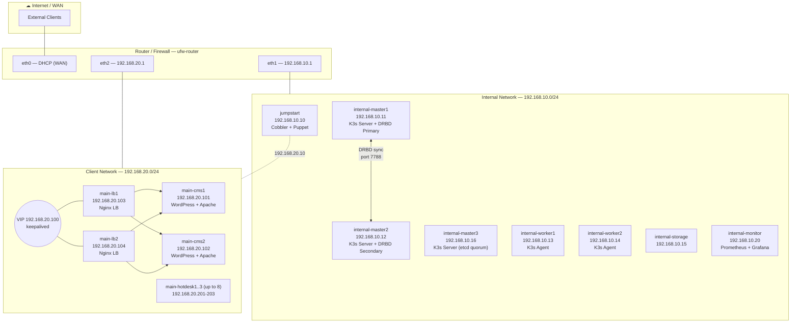

# CMS High-Availability Infrastructure — Fully Automated Deployment

<div align="center">

[](docs/SOFTWARE_BASELINE.md)
[]()
[](cmd/cms-ha/)
[](ansible/)
[](.github/workflows/ci.yml)
[]()

**Production-grade, zero-touch infrastructure for a high-availability Content Management System.**  
*14+ VMs · 2 segmented networks · 11 deployment phases · single Go binary · fully idempotent*

</div>

---

## Overview

This project implements the **complete design, provisioning, and automation** of an enterprise-grade high-availability IT infrastructure running a WordPress CMS — from bare-metal OS installation to full-stack observability.

The entire environment is deployed with a **single command** (`cms-ha deploy`), requiring zero manual intervention across 16 virtual machines, 2 isolated network segments, and 11 orchestrated deployment phases.

### Orchestration Engine

The environment is driven by three cooperating layers:

- **`cms-ha` (Go CLI orchestrator)** — the supported entry point: a statically compiled binary with an integrated SSH connection pool, bounded worker semaphore concurrency, type-safe YAML configuration, `age`-based secret encryption, structured logging (`slog`), self-healing routines, phase checkpoints (`--resume` / `--from-phase`) and sub-second health verification.
- **Ansible** (`ansible/`) — declarative *creation* of the libvirt networks and VM domains from `config.yaml`.
- **Puppet** (`puppet/`) — node *desired state* (packages, services, exporters, `/etc/hosts`, …).

> The legacy **v1 shell suite** (`scripts/`, `deploy_all.sh`) is **deprecated and
> no longer maintained**; it is kept for historical reference only. See
> [`scripts/README.md`](scripts/README.md) for the complete v1 → v2 mapping.

### Key Technical Highlights

| Area | Implementation |
|:-----|:---------------|
| **Zero-touch Provisioning** | Cobbler PXE server + Ubuntu autoinstall for unattended OS deployment |
| **Idempotent Configuration** | Puppet 8 agent/server model with role-based manifests & auto SSL self-healing |
| **HA Clustering** | K3s (lightweight Kubernetes) with 3 server nodes (embedded etcd, tolerates 1 failure) + 2 agent nodes |
| **Synchronous Block Replication** | DRBD 9 Protocol C between master nodes for zero data loss with dynamic node affinity |
| **Automated Failover** | Autonomous DRBD watchdog daemon (`drbd-failover-watchdog.service`) + gateway quorum verification + Kubernetes pod migration + chaos testing suite |
| **Load Balancing** | Nginx reverse proxy with health checks across 2 WordPress/Apache frontends |
| **Full-stack Observability** | Prometheus + Grafana with 19 alert rules (DRBD/etcd quorum, keepalived VIP, service & backup health) and dynamic scrape targets |
| **Defense in Depth** | UFW perimeter firewall + dynamic WAN MAC detection + per-node iptables rules + network segmentation |
| **Internal PKI** | Private Certificate Authority (step-ca) with automated TLS trust distribution |
| **Infrastructure as Code** | Ansible (`community.libvirt`) creates & declares networks, disks and VM domains |
| **Automated Backups** | Daily dump + off-DRBD upload to a Garage S3 store (container on the hypervisor), automated restore drill, `BackupMissing` alert |
| **Secret Hardening** | `age` (X25519) auto-encryption of `config.yaml` secrets on first load (key kept at `~/.config/cms-ha/`, never committed); K3s join token distributed as a `0600` file — never in argv; database/WordPress/CA credentials supplied at runtime in the shell suite |
| **Access Hardening** | Non-root deploy account (`ssh.user`) with transparent `sudo -n`; direct root SSH disabled (`PermitRootLogin no`) on every node; SSH host keys pinned on first use (TOFU, fail-closed on mismatch) — see `docs/SECURITY.md` |
| **Strict Failure Semantics** | Every remote command's exit code is verified per phase; broken DRBD/K3s state aborts the deploy instead of reporting silent success; failover tests validate shutdown and report un-runnable scenarios as `SKIP` |
| **CI/CD Pipeline** | GitHub Actions: Go test (-race), ShellCheck, yamllint, kubeconform, puppet-lint, ansible-lint, and a security job (`gosec` + `govulncheck` + `Trivy`) |

> **Verified End-to-End Deployment** — The full infrastructure has been deployed, stress-tested, and validated end-to-end on KVM hypervisor environments (27 GB RAM limit), confirming flawless operation of all components: automated PXE provisioning, parallel Puppet convergence, K3s HA cluster, WordPress reachability via HTTPS (`200 OK`), DRBD replication, UFW NAT forwarding, and Prometheus metrics collection (`cms-ha verify` passing 100%).

---

## Architecture

The network is segmented into **two isolated subnets** connected by a UFW router/firewall:

| Network | CIDR | Purpose |
|:--------|:-----|:--------|
| **internal** | `192.168.10.0/24` | K3s cluster, MariaDB, DRBD replication, monitoring, provisioning |
| **main** | `192.168.20.0/24` | Load balancer, CMS frontends (WordPress), hot-desk workstations |



> For detailed topology, service, and deployment sequence diagrams see [`docs/NETWORK_DIAGRAM.md`](docs/NETWORK_DIAGRAM.md).

---

## Technology Stack

| Component | Technology | Version | Purpose |
|:----------|:-----------|:--------|:--------|
| Operating System | Ubuntu Server | 24.04 LTS | Base OS for all nodes |
| Bare-metal Provisioning | Cobbler | 3.3.x | PXE + autoinstall for unattended deployment |
| Configuration Management | Puppet | 8.x | Declarative, agent-based configuration |
| Container Orchestration | K3s | v1.29.x | Lightweight Kubernetes for HA clustering |
| Database | MariaDB | 10.11.x | StatefulSet inside K3s cluster |
| CMS | WordPress | 6.x | Content Management System |
| Web Server | Apache | 2.4.x | CMS frontend server with PHP 8.3 |
| Load Balancer | Nginx | 1.24.x | Reverse proxy with upstream health checks |
| Block Replication | DRBD | 9.x | Synchronous Protocol C replication |
| Metrics Collection | Prometheus | 2.x | Time-series monitoring with exporters |
| Alerting | Prometheus alert rules (19) + Alertmanager | 2.x / 0.23 | Availability, DRBD/etcd quorum, keepalived, service & backup health; routed and deduplicated by Alertmanager |
| Dashboards | Grafana | 11.x | Metrics visualisation and dashboards |
| Firewall | UFW | — | Perimeter and per-node iptables rules |
| PKI / TLS | step-ca | 0.27.x | Internal Certificate Authority |
| Infrastructure Provisioning | Ansible + community.libvirt | 2.16 | Declarative network/VM creation from `config.yaml` |
| Virtualisation | KVM / QEMU / libvirt | — | Hypervisor and VM management |

> Full software inventory with versions, dependencies, and download URLs: [`docs/SOFTWARE_BASELINE.md`](docs/SOFTWARE_BASELINE.md)

---

## Repository Structure

```
CMS-HA-Infrastructure/
├── README.md                        # This file
├── Makefile                         # Build, deploy, lint, and ops targets
├── config.yaml                      # Centralised typed configuration (age-encrypted secrets)
├── go.mod / go.sum                  # Go module definition
│
├── cmd/cms-ha/                      # CLI entry point (Cobra)
│   ├── main.go                      # Binary entry point
│   └── root/                        # Command definitions
│       ├── root.go                  # Root command + global flags (--config, --verbose, --dry-run)
│       ├── phase.go                 # cms-ha phase <name>  (all 11 phases)
│       ├── deploy.go                # cms-ha deploy        (full orchestration)
│       ├── vm.go                    # cms-ha vm <action>   (start, stop, shrink, fix-boot-order, ...)
│       ├── cleanup.go               # cms-ha cleanup       (destroy all VMs, disks, and networks)
│       ├── verify.go                # cms-ha verify        (health check)
│       ├── test.go                  # cms-ha test failover (chaos engineering)
│       ├── traffic.go               # cms-ha traffic       (k6 load test)
│       ├── repair.go                # cms-ha repair k8s|clocks
│       ├── secrets.go               # cms-ha secrets encrypt|decrypt|generate-key
│       └── ...                      # backup, status, lint
│
├── internal/                        # Core Go packages (not importable externally)
│   ├── config/                      # Typed config loader (viper) + age encryption
│   ├── ssh/                         # SSH connection pool + SFTP + parallel execution
│   ├── libvirt/                     # virsh/virt-install/qemu-img wrapper
│   ├── logging/                     # Coloured structured logging (slog + fatih/color)
│   ├── retry/                       # Retry/poll primitives with context
│   ├── templates/                   # Go template renderer with embed.FS
│   ├── deploy/                      # Orchestrator — coordinates all phases
│   ├── lint/                        # External linter runner (shellcheck, yamllint, ...)
│   ├── utils/                       # VM ops, verify, failover, repair, status
│   └── phases/                      # Phase implementations (one package per phase)
│       ├── initvms/                 # 00 — VM creation (libvirt/cloud-init/PXE)
│       ├── cobbler/                 # 01 — Cobbler PXE server setup
│       ├── registernodes/           # 02 — Register nodes in Cobbler
│       ├── repairssh/               # 03 — SSH + Puppet CA repair
│       ├── puppet/                  # 04 — Puppet Server/Agent deployment
│       ├── drbd/                    # 05 — DRBD block replication
│       ├── kubernetes/              # 06 — K3s HA cluster + MariaDB
│       ├── nginx/                   # 07 — Nginx LB + WordPress frontends
│       ├── monitoring/              # 08 — Prometheus + Grafana
│       ├── ufw/                     # 09 — UFW perimeter firewall
│       ├── pki/                     # 10 — Internal CA (step-ca)
│       └── traffic/                 # 11 — k6 load generator (pinned grafana/k6 container)
│
├── scripts/                         # Legacy v1 shell scripts — DEPRECATED (see scripts/README.md)
├── kubernetes/                      # K3s manifests — Kustomize tree (base/ + monitoring/ + overlays/ + backups/ + jobs/)
├── puppet/                          # Puppet manifests and modules (role-based)
├── templates/                       # Configuration templates (Go text/template)
├── ansible/                         # Infra as code: libvirt networks + VM domains (create/declare)
├── tests/integration/run.sh         # End-to-end integration driver (deploy + verify + failover)
├── docs/SECURITY.md                 # Non-root access, host-key TOFU, CI scanning model
├── .github/workflows/ci.yml         # CI: build/tests + lint + kustomize/kubeconform + ansible-lint + security scan
└── .github/workflows/integration.yml # CI: end-to-end lab run on a self-hosted KVM runner
```

---

## Quick Start

### Prerequisites

- Linux host (AMD64) with **KVM/QEMU** and **libvirt** installed
- **Go 1.22+** (for building from source) or download the pre-built binary
- At least **16 GB RAM** (27 GB recommended for full deployment)
- Ubuntu 24.04 Server ISO
- SSH key pair for cluster management

### Build

```bash
git clone https://github.com/Aitor42/CMS-HA-Infrastructure.git
cd CMS-HA-Infrastructure

# Build the CLI binary
make build

# Or directly with Go
go build -o cms-ha ./cmd/cms-ha/
```

### Deployment

```bash
# Edit config.yaml to match your environment
vim config.yaml

# Set database passwords and wordpress.admin_password in config.yaml as plain text.
# The first cms-ha operation that loads the config encrypts non-empty secrets automatically.
# The configuration (CIDRs, node IPs/MACs/FQDNs, hotdesk bounds, HA quorum) is validated on every run.
./cms-ha deploy

# Preview all 12 pipeline steps without executing anything (--dry-run only works in deploy)
./cms-ha deploy --dry-run

# Or resume with pre-installed VMs
./cms-ha deploy --skip-vm-create

# Run a specific phase
./cms-ha phase setup-drbd

# Verbose output
./cms-ha -v deploy
```

The legacy Bash deployment does not use the Go CLI's automatic encryption. Before using it, provide `DB_PASS`, `DB_ROOT_PASS`, `DB_EXPORTER_PASS`, and `WP_ADMIN_PASS` through the environment; avoid storing those values in shell scripts or committed files.

The orchestrator executes all phases sequentially: VM Init (jumpstart) → Cobbler → Register Nodes → VM Init (clients) → Repair SSH → Puppet → DRBD → K3s → Nginx & WordPress → Monitoring → UFW → Internal CA (12 pipeline steps, from 11 distinct phases; `--skip-vm-create` drops the two VM Init steps for a 10-step run).

### Provisioning with Ansible (Infrastructure as Code)

The VM/network layer is declared in Ansible and generated from `config.yaml`
(the single source of truth):

```bash
# Generate the inventory from config.yaml
./cms-ha inventory

# Create networks + disks + domains (idempotent)
make provision            # or: cd ansible && ansible-playbook playbooks/provision.yml
make provision-check      # dry run

# Then run the service phases (Cobbler, Puppet, K3s, ...)
./cms-ha deploy --skip-vm-create
```

Ansible only *creates and declares* infrastructure. Runtime operations
(start/stop/shrink) and fencing stay on the thin `libvirt`/`virsh` primitive in
the Go CLI — see [`ansible/README.md`](ansible/README.md) for the boundary.

> **Migration window:** the legacy Go `init-vms` phase is intentionally kept as
> a fallback until `provision.yml` has been validated against a real hypervisor.
> After that, provisioning goes through Ansible only.

---

## Deployment Phases

Each phase is invoked through the unified Go CLI (`cms-ha`). The third column lists the **deprecated** v1 shell script the phase replaced; it is kept only as a reference (see [`scripts/README.md`](scripts/README.md)) and must not be used for new work. The `Phase` numbers below are the **Technical Execution Sequence** (the `cms-ha phase` subcommands); they are intentionally distinct from the **Project Milestones** (`docs/phases/PHASE-00..11`, e.g. PHASE-03 = *HA Cluster and Database*) and from the **verification check numbers** (00-07). See `docs/PLAN.md` → *Project Phases & Deployment Mapping* for the full cross-reference.

| Phase | Go CLI Command (v2) | Deprecated v1 script | Target Nodes | Description |
|:-----:|:--------------------|:-----------------|:-------------|:------------|
| **00** | `cms-ha phase init-vms` | `scripts/00_init_vms.sh` | Hypervisor (16 VMs) | Virtual networks and VM domain creation via libvirt/KVM |
| **01** | `cms-ha phase setup-cobbler` | `scripts/01_setup_cobbler.sh` | `jumpstart` | Cobbler PXE server, DHCP, TFTP, DNS (BIND9) & NFS |
| **02** | `cms-ha phase register-nodes` | `scripts/02_register_cobbler_nodes.sh` | `jumpstart` | Host profile definitions, static IPs and MAC bindings |
| **03** | `cms-ha phase repair-ssh` | `scripts/03_repair_ssh_puppet.sh` | All client nodes | Post-install SSH key synchronization & Puppet CA reset |
| **04** | `cms-ha phase setup-puppet` | `scripts/04_setup_puppet.sh` | `jumpstart` + 13 clients | Bounded parallel Puppet catalog execution with SSL healing |
| **05** | `cms-ha phase setup-drbd` | `scripts/05_setup_drbd.sh` | `internal-master1/2` | DRBD 9 synchronous block replication (Protocol C) |
| **06** | `cms-ha phase setup-kubernetes` | `scripts/06_setup_kubernetes.sh` | Masters + Workers | K3s HA cluster, DRBD node affinity labeling & MariaDB |
| **07** | `cms-ha phase setup-nginx-wordpress` | `scripts/07_setup_nginx_wordpress.sh` | `main-lb1/2`, `main-cms1/2` | Nginx reverse proxy (+ keepalived VIP) & WordPress/Apache frontends |
| **08** | `cms-ha phase setup-monitoring` | `scripts/08_setup_monitoring.sh` | `internal-monitor` + all | Prometheus, Grafana, alert rules, blackbox probes & node exporters |
| **09** | `cms-ha phase setup-ufw` | `scripts/09_setup_ufw.sh` | `ufw-router` + all nodes | Perimeter routing, dynamic WAN NAT & per-node UFW |
| **10** | `cms-ha phase setup-ca` | `scripts/10_setup_internal_ca.sh` | `jumpstart` + all nodes | Smallstep PKI (step-ca) & cluster-wide TLS trust |
| **11** | `cms-ha traffic` | `scripts/11_traffic_mix.sh` | Workstations & LB | k6 HTTP load/smoke profile (RPS, p95/p99, error rate) with optional Prometheus remote-write |

---

## Orchestrator Architecture & Concurrency Model

The Go orchestrator (`cmd/cms-ha` and `internal/`) was engineered to replace serial bash loops with enterprise-grade concurrent execution patterns, connection reuse, and self-healing safeguards.

### 1. SSH Connection Pooling (`internal/ssh`)
- **Persistent Connection Multiplexing:** Maintains an active pool of authenticated SSH clients per IP, eliminating the overhead of negotiating TLS handshakes on every command.
- **Thread-Safe Operations:** Protected by `sync.RWMutex` with lazy-initialization on first call and safe concurrent execution across multiple goroutines.
- **In-Memory Streaming:** Direct SFTP/SCP payload delivery (`CopyContent`) without relying on external file artifacts on the hypervisor host.

### 2. Bounded Concurrency & Staged Execution
- **Worker Semaphore Pool (Puppet):** Rather than spawning unbounded goroutines that would exhaust the Puppet Master's CPU and memory (causing connection timeouts and 500 errors), `setup-puppet` utilizes a worker semaphore pool with a concurrency limit of **4**. This accelerates convergence across 13 client nodes from >7 minutes down to **~90 seconds**.
- **Staged Master Convergence:** The orchestrator guarantees that the `role::jumpstart` Puppet manifest converges *before* any client node executes. This ensures that Puppet Server (8140), DNS (53), Cobbler (25151), DHCP (67), and TFTP (69) are actively listening before clients request catalogs.
- **Sequential DB Initialization Guard:** In `setup-nginx-wordpress`, CMS frontends are converged sequentially (`main-cms1` followed by `main-cms2`) to prevent concurrent race conditions during the initial WordPress core database schema generation on MariaDB.
- **Parallel Exporter & Firewall Convergence:** Phases `setup-monitoring`, `setup-ufw`, and `setup-ca` fan out in parallel across all cluster nodes with automatic progress tracking and aggregated error reporting.

### 3. Self-Healing & Distributed State Resilience
- **Puppet SSL Self-Healing:** Detects SSL certificate discrepancies (`certificate verify failed`) automatically. If a node has a stale certificate, the orchestrator revokes and cleans the certificate on the master, deletes local SSL data on the client, regenerates a fresh CSR, signs it, and re-executes the catalog cleanly.
- **Dual FQDN & Short Hostname Resolution:** DRBD resource configurations (`templates/drbd/cms-data.res`) and Kubernetes node affinity labeling (`kubectl label node ... drbd-status=primary`) dynamically match both FQDN (`internal-master1.internal.local`) and short hostname (`internal-master1`), guaranteeing that storage mounts and pod affinity never get trapped in `Pending` states.
- **Idempotent NAT Table Injection:** In `setup-ufw`, the router discovers the dynamic WAN interface by MAC address (`52:54:00:10:00:02` -> `enp3s0`), strips existing NAT blocks to prevent duplicate accumulation, and injects the `*nat` table cleanly before `*filter` in `/etc/ufw/before.rules`.

### 4. Asymmetric Secret Management (`internal/config`)
- Sensitive values (database, exporter, WordPress administrator, and provisioner passwords) can be entered in `config.yaml`; the CLI encrypts them automatically on first config load using `age` (X25519).
- The generated private identity is stored at `~/.config/cms-ha/age.key`, outside the repository. Keep a secure backup; built-in manual key/encrypt/decrypt commands are also available.

---

## Operations & Verification Reference

### Full Infrastructure Health Check

Run the comprehensive, parallel health verifier:

```bash
# Supported: runs 8 checks in parallel in ~1.5s
./cms-ha verify

# Deprecated v1 equivalent (reference only, see scripts/README.md)
bash scripts/utils/verify_all.sh
```

Example output from a fully converged environment:

```text
ℹ Starting phase: Infrastructure Verification
✓ Phase 00 - Libvirt VMs & Networks: [PASS] (15 running VMs)
✓ Phase 01 - Cobbler Services & Systems: [PASS] (Systems: 13)
✓ Phase 02 - Puppet Server & Certs: [PASS] (Certs: 13)
✓ Phase 03 - Nginx & Apache & SSL: [PASS]
✓ Phase 04 - K3s & MariaDB Pod: [PASS]
✓ Phase 05 - Prometheus & Grafana: [PASS]
✓ Phase 06 - Router UFW & IP Forward: [PASS]
✓ Phase 07 - DRBD Status: [PASS] (Verified on 192.168.10.11)
✓ Completed phase: Infrastructure Verification in 1.52s
```

### SSH Connectivity Matrix

```bash
./cms-ha status ssh
```

```text
VM NAME              IP              STATE      SSH       
------------------------------------------------------------
ufw-router           192.168.10.1    running    OK        
jumpstart            192.168.10.10   running    OK        
internal-master1     192.168.10.11   running    OK        
internal-master2     192.168.10.12   running    OK        
internal-master3     192.168.10.16   running    OK        
internal-worker1     192.168.10.13   running    OK        
internal-worker2     192.168.10.14   running    OK        
internal-storage     192.168.10.15   running    OK        
internal-monitor     192.168.10.20   running    OK        
main-lb1             192.168.20.103  running    OK        
main-lb2             192.168.20.104  running    OK        
main-cms1            192.168.20.101  running    OK        
main-cms2            192.168.20.102  running    OK        
main-hotdesk1        192.168.20.201  running    OK        
main-hotdesk2        192.168.20.202  running    OK        
main-hotdesk3        192.168.20.203  running    OK        
```

### VM Management Commands

```bash
# Start all VMs defined in configuration
./cms-ha vm start

# Gracefully power off all running cluster VMs
./cms-ha vm stop

# Optimize memory after installation (reduces VMs from 3-4 GB down to production profiles)
./cms-ha vm shrink

# Fix boot order across all VMs (sets primary boot to disk to avoid PXE loops)
./cms-ha vm fix-boot-order

# Clean up failed installation domains safely
./cms-ha vm recreate-failed

# Destroy and wipe all cluster VMs, disk images, and virtual networks
./cms-ha cleanup            # asks for confirmation (add --yes to skip)
```

---

## Observability

| Service | URL | Purpose |
|:--------|:----|:--------|
| Prometheus | `http://192.168.10.20:9090` | Metrics collection and alerting engine (`/alerts` shows firing alerts) |
| Grafana | `http://192.168.10.20:3000` | Dashboards and visualisation (node overview + HA overview) |
| Alertmanager | `http://192.168.10.20:9093` | Alert routing, grouping and deduplication; add a webhook/email/Slack receiver to enable delivery (see `docs/MANUAL.md` §4) |

### Alert Rules

19 preconfigured alerts covering infrastructure, service, and high-availability health:

| Alert | Severity | Trigger |
|:------|:---------|:--------|
| NodeDown | critical | Node exporter unreachable > 2 min |
| BlackboxProbeFailed | critical | HTTP/TCP probe fails > 2 min |
| ProbeLatencyHigh | warning | Probe p95 > 2 s > 5 min |
| DiskSpaceCritical | critical | Filesystem < 10% free > 1 min |
| DiskSpaceWarning | warning | Filesystem < 20% free > 5 min |
| HighMemoryUsage | warning | Memory usage > 85% > 5 min |
| MariaDBDown | critical | MariaDB exporter unreachable > 1 min |
| NginxDown | critical | Nginx exporter unreachable > 1 min |
| ApacheDown | warning | Apache exporter unreachable > 2 min |
| K3sNodeNotReady | critical | Kubelet unreachable > 3 min |
| HighHTTP5xxRate | warning | HTTP 5xx rate > 5% over 5 min |
| PrometheusTargetMissing | warning | Any scrape target down > 5 min |
| BackupMissing | warning | No successful offsite backup > 26 h |
| BackupRestoreTestFailing | warning | Restore drill failing > 48 h |
| EtcdNoQuorum | critical | Fewer than 2 of 3 etcd members reachable / no leader |
| DRBDPeerDown | critical | DRBD replication link down > 2 min |
| DRBDSplitBrain | critical | DRBD resource StandAlone/WFConnection > 1 min |
| DRBDNoPrimary | critical | No node holds the DRBD Primary role > 2 min |
| KeepalivedState | critical | VIP not held by exactly one balancer > 2 min |

---

## Load Testing (k6)

HTTP load/smoke generation is delegated to [k6](https://k6.io/), run from a
pinned `grafana/k6` container on the hypervisor (docker/podman required). The
profile lives in `templates/traffic/cms-smoke.js` and exercises the WordPress
surface (home, search, REST API, feeds, login) with pass/fail thresholds on the
error rate and p95/p99 latency.

```bash
# External (through the keepalived VIP) — the default
./cms-ha traffic

# From the internal network against a CMS frontend
./cms-ha traffic --internal

# Custom duration / virtual users, plus the MariaDB round-trip check
./cms-ha traffic --duration 120 --concurrency 10 --with-db
```

Set `traffic.prometheus_rw_url` in `config.yaml` to stream k6 metrics
(`k6_http_reqs_total`, `k6_http_req_duration_seconds_*`) into Prometheus, so the
**HA overview** Grafana dashboard shows RPS and latency during the test.

---

## Chaos Engineering

Automated failover tests validate the HA design under real failure conditions:

```bash
./cms-ha test failover

# Inspect state without restoring
./cms-ha test failover --skip-restore
```

| Test | Simulated Failure | Validated Behaviour |
|:-----|:------------------|:-------------------|
| DRBD Master Failover | Primary master node shutdown | Watchdog detects failure (15s), promotes Secondary, migrates MariaDB pod, CMS stays online |
| CMS Frontend Failover | WordPress node shutdown | Nginx routes traffic to surviving frontend with zero downtime |
| K3s Worker Failover | Worker node shutdown | Pods reschedule to remaining worker |

---

## End-to-End Integration Test

`tests/integration/run.sh` (also `make integration`) drives the whole pipeline on
a real KVM host: **build → `deploy` → `verify` → `test failover`**. It is the job
that `.github/workflows/integration.yml` runs on a **self-hosted runner labelled
`kvm`** (nightly and on demand), because it needs libvirt and `/dev/kvm`.

```bash
make integration           # full deploy + verify + failover
make integration-resume    # resume from the deploy.state checkpoint
tests/integration/run.sh --skip-deploy --skip-chaos   # verify only
```

The deployment checkpoint (`deploy.state`) is collected as a CI artifact so a
failed run can be resumed with `./cms-ha deploy --resume`.

---

## Documentation

| Document | Description |
|:---------|:------------|
| [PLAN.md](docs/PLAN.md) | Architecture plan, node inventory, and design decisions |
| [MANUAL.md](docs/MANUAL.md) | Operations manual — deployment, scaling, failover, troubleshooting |
| [SOFTWARE_BASELINE.md](docs/SOFTWARE_BASELINE.md) | Complete software inventory with versions and URLs |
| [NETWORK_DIAGRAM.md](docs/NETWORK_DIAGRAM.md) | Network topology and service architecture diagrams |
| [phases/](docs/phases/) | Per-phase technical documentation |

---

## CI Pipeline

The GitHub Actions CI validates every push and pull request:

| Job | Tool | Scope |
|:----|:-----|:------|
| **Go Build & Test** | `go build` + `go vet` + `go test` | CLI binary compilation + unit tests |
| Shell Lint | ShellCheck + `bash -n` | All `.sh` scripts |
| YAML Lint | yamllint | Kubernetes manifests, monitoring configs |
| K8s Validation | kubeconform | Kubernetes manifests against v1.29 schemas |
| Puppet Lint | puppet-lint | All `.pp` manifests |
| Ansible Validate | `ansible-lint` + `--syntax-check` | Playbooks, roles and inventory |
| Security Scan | gosec + govulncheck + Trivy | Go SAST, dependency CVEs, secrets/misconfig |
| Integration (KVM lab) | `tests/integration/run.sh` | Self-hosted `kvm` runner: deploy + verify + DRBD failover (nightly / on demand) |

---

## License

This project is licensed under the MIT License.
