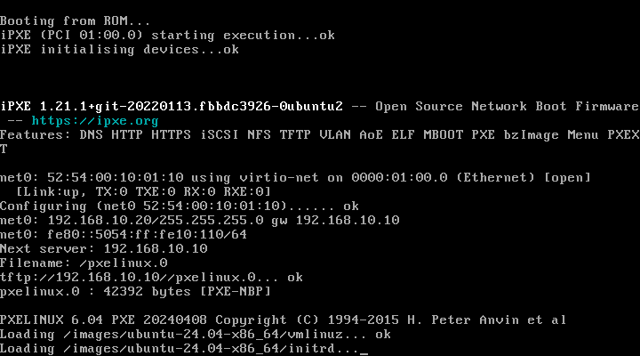

# Operations Manual — CMS High-Availability Infrastructure

> **Version:** 2.1  
> **Date:** October 2026

This manual describes the procedures to deploy, administer, and maintain the WordPress CMS high-availability infrastructure. The solution is optimised to run on a KVM hypervisor host under physical memory constraints (~27 GB RAM).

> **What's new in 2.1** — Hardened CLI error handling (errors to stderr, exit code 1), strict configuration validation on load, dry-run restricted to `cms-ha deploy`, per-command remote exit-code verification in every provisioning phase (DRBD, Cobbler, PKI, Kubernetes fail the deployment on real errors instead of reporting success with broken state), K3s join token distributed as a protected file, Prometheus bound to a least-privilege ClusterRole with a rotatable 1-year token, and an idempotent SSH/SFTP layer (atomic remote writes, bounded reads/waits).

---

## Table of Contents

1. [Prerequisites](#1-prerequisites)
2. [Deployment Procedure (Batch Mode)](#2-deployment-procedure-batch-mode)
3. [Deployment Verification](#3-deployment-verification)
4. [Monitoring and Metrics](#4-monitoring-and-metrics)
5. [Scaling and Node Expansion](#5-scaling-and-node-expansion)
6. [Maintenance and Backups](#6-maintenance-and-backups)
7. [Failover and Disaster Recovery](#7-failover-and-disaster-recovery)
8. [Lab Resume Procedure](#8-lab-resume-procedure)

---

## 1. Prerequisites

### 1.1 Hypervisor Host Hardware
*   **CPU**: Minimum 4 physical cores (recommended: 8+ vCPUs).
*   **RAM**: 27 GB physical limit in the lab environment.
*   **Disk**: Minimum 60 GB free in `/home` (VM disks are stored at `/home/$USER/vm_storage` to avoid filling the root partition).
*   **Network**: At least 1 interface with internet access for NAT.

### 1.2 Required Software on the Hypervisor
The physical host must have the KVM hypervisor and libvirt library installed:
```bash
sudo apt update
sudo apt install -y qemu-kvm libvirt-daemon-system virtinst bridge-utils
```
The user must belong to the `libvirt` group to manage VMs without direct root privileges:
```bash
sudo usermod -aG libvirt $USER
newgrp libvirt
```

### 1.3 CLI Behaviour and Configuration Validation (v2.1)

*   **Error handling**: command errors are printed once to **stderr** and the process exits with code `1`. Nothing is retried silently; failures surface where they occur.
*   **`--dry-run` is only implemented by `cms-ha deploy`.** Passing it to any other command is rejected up front, so no other operation runs with real effects while pretending to simulate.
*   **Configuration validation** runs on every `cms-ha` invocation before any network or VM operation. The load aborts with a precise message (naming the offending node) when:
    - `network.internal.cidr` / `network.main.cidr` are not valid CIDRs;
    - any node IP is not a valid IPv4 address, FQDN contains characters outside letters/digits/dots/hyphens, or a MAC address is malformed — these fields are interpolated into SSH commands, Cobbler registrations and `awk` filters;
    - the hotdesk IP range would overflow (base octet + count must stay ≤ 254, e.g. 40 hotdesks from octet 250 is rejected before generating `192.168.20.256`);
    - `vm.storage_dir` is missing, fewer than 3 master nodes (or an even number) are configured (etcd quorum), the LB IP is unset, or there is no CMS frontend.
*   **`NUM_HOTDESKS`** overrides the hotdesk count dynamically; an invalid value is ignored with a `WARN` instead of silently altering the topology.
*   **Quality gate**: `./cms-ha lint` runs the Go linters (`go vet`, `staticcheck`) plus ShellCheck/yamllint/puppet-lint/kubeconform/ansible-lint for the subsets that are installed and whose directories exist; if nothing could run, it warns instead of reporting a false green.
*   **Security gate**: `make security` runs **gosec** (Go SAST), **govulncheck** (reachable dependency CVEs) and **Trivy** (filesystem vulns/secrets/misconfig). CI fails on any HIGH/CRITICAL finding in code, dependencies or secrets; Kubernetes misconfig is reported but not blocking (see the *Security Hardening* subsection above and `docs/SECURITY.md`).

### 1.4 Security Hardening (Non-Root Access, Host Keys, Scanning)

*   **Non-root deploy account.** `cms-ha` never logs in as `root`. Every VM connection uses `ssh.user` (default `ubuntu`, provisioned by the installers with an authorised key) and privileged commands are elevated transparently with `sudo -n -H`. Direct root SSH is disabled on every provisioned node (`PermitRootLogin no`).
*   **Host-key pinning (TOFU).** VM host keys are pinned on first contact and stored in `ssh.known_hosts_file` (default `~/.ssh/cms_known_hosts`). A later mismatch **fails closed** instead of silently trusting a changed key (MITM protection).
*   **Secrets at rest.** Service passwords and `backup.secret_key` are age-encrypted on first load; the identity and recipient live outside the repository (`${HOME}/.config/cms-ha`).
*   See `docs/SECURITY.md` for the full model, the accepted risks, and the CI scanner configuration.

---

## 2. Deployment Procedure (Batch Mode)

Due to the **27 GB RAM limit**, launching all 16 VMs simultaneously with the Ubuntu 24.04 installer's minimum requirements (3-4 GB per node) would cause the host to run out of memory (OOM). Therefore, the initial deployment is performed **interactively in batches**.

### Before the First Deployment: Set Service Passwords

Edit `config.yaml` and enter the desired service passwords in plain text:

```yaml
database:
  password: "<contraseña-para-wp_user>"
  root_password: "<contraseña-de-root>"
  exporter_password: "<contraseña-del-exporter>"

wordpress:
  admin_password: "<contraseña-del-administrador>"

pki:
  provisioner_password: "<contraseña-de-la-CA>"
```

No separate encryption command is needed. The first `cms-ha` operation that loads the config automatically creates a local `age` key outside the repository, encrypts non-empty secret fields in `config.yaml` in place, and then loads the decrypted values for deployment. Keep the local key at `~/.config/cms-ha/age.key` safe and backed up; without it, the encrypted configuration cannot be used. A legacy project-local `private.key` is migrated to this directory (or retained there as `legacy.age.key` if another key is already in use). Do not commit `config.yaml` until the first `cms-ha` operation that loads it has completed.

K3s is installed with Kubernetes Secret encryption at rest enabled. This protects Secrets stored in etcd for newly initialized clusters; an already running cluster that the setup script skips is not retroactively migrated by this option. Follow the K3s secrets-encryption migration procedure before relying on it for an existing cluster.

For the legacy Bash workflow, provide `DB_PASS`, `DB_ROOT_PASS`, `DB_EXPORTER_PASS`, and `WP_ADMIN_PASS` as environment variables (and `CA_PROVISIONER_PASSWORD` when running `scripts/10_setup_internal_ca.sh`). That workflow does not automatically encrypt `config.yaml`, and no credential is stored in any script.

Changing `database.password` or `database.exporter_password` later requires rerunning the database initialization Job and Puppet setup so MariaDB and the clients receive the same credentials. `database.root_password` initializes the MariaDB data directory; changing it in the config does not rotate the root account in an existing persistent volume. Rotate that account in MariaDB first, then update the config, or the initialization Job will no longer be able to authenticate. `wordpress.admin_password` is used only during the first WordPress installation; changing it later does not change the existing administrator account. Keep `pki.provisioner_password` stable after CA initialization because it unlocks the existing CA key.

### Step 1: Provision the Jumpstart Node and Configure Cobbler
On the hypervisor terminal, run the Go CLI (or legacy scripts) to create virtual networks and install the central provisioning node (`jumpstart`):
```bash
# 1. Create networks and launch the jumpstart VM
./cms-ha phase init-vms --jumpstart-only
# (Legacy v1: bash scripts/00_init_vms.sh --jumpstart-only)

# 2. Configure Cobbler server, DHCP, and NFS
./cms-ha phase setup-cobbler
# (Legacy v1: bash scripts/01_setup_cobbler.sh)

# 3. Register client node templates and profiles in Cobbler
./cms-ha phase register-nodes
# (Legacy v1: bash scripts/02_register_cobbler_nodes.sh)
```

### Step 2: Sequential Installation and RAM Adjustment (Batches)

Run the command that automates the creation and installation of client nodes in sequential batches:
```bash
# Go CLI:
./cms-ha vm install-batches

# (Legacy v1: bash scripts/utils/install_by_batches.sh)
```
**Key Operational Decisions During Batch Provisioning:**
*   **Installation RAM Allocation:** VMs are spawned with 3–4 GB RAM so the Subiquity installer does not trigger Linux kernel OOM killer events.
*   **Production Disk Sizing:** The web frontends (`main-cms1`, `main-cms2`) and load balancers (`main-lb1`, `main-lb2`) are provisioned with **8 GB virtual disks** (upgraded from earlier 4 GB baseline) to provide ample room for Apache, PHP 8.3 modules, WordPress core files, Nginx logs, and OS kernel updates without risk of root partition exhaustion.
*   **Automated Memory Shrinking:** Once a batch finishes OS installation, its memory is adjusted down to production footprint (768 MB – 2048 MB):
    ```bash
    ./cms-ha vm shrink
    # (Legacy v1: bash scripts/utils/shrink_vm_ram.sh)
    ```
*   **Boot Order Hardening:** To ensure rebooted VMs boot directly from disk instead of re-entering PXE bootstrap loops:
    ```bash
    ./cms-ha vm fix-boot-order
    ```
*   **Batch SSH Budget:** `deploy.node_install_timeout` (default `15m`) bounds how long a whole batch may take to install and answer SSH. The nodes of a batch install in parallel and share the host's vCPUs, so hosts with few cores need a larger budget — the hosted CI lab, which has 4 vCPU for the entire topology, uses `20m`.
*   **Watching for the installed system, not the installer:** During a batch the live installer answers on port 22 too, but it refuses the deployment key by design; only the installed system accepts it. If a node goes silent right after its installer was answering, its shutdown wedged (the live media is an NFS mount whose squashfs stays loop-mounted, so `/cdrom` cannot be unmounted and the guest never reboots). The batch restarts such a node from the host, and since the boot order is already disk-first it comes straight back into the installed system. A healthy node reboots well inside that window and is never restarted.

The following screenshot shows the automated PXE network installation process via Cobbler:



### Step 3: Service and Application Deployment
Once all VMs are running and adjusted to production profiles, run the deployment orchestrator:
```bash
# Go CLI (VMs already installed; skips VM creation):
./cms-ha deploy --skip-vm-create

# Full run (creates the networks and VMs first):
./cms-ha deploy

# The orchestrator writes a checkpoint (deploy.state) after every phase, so a
# failed run can resume instead of starting over:
./cms-ha deploy --resume                    # skip phases already completed
./cms-ha deploy --from-phase drbd-setup     # start at a named phase
./cms-ha deploy --state-file /var/tmp/deploy.state

# (Or Makefile: make deploy-resume)
# (Deprecated v1: ./deploy_all.sh --skip-vm-create)
```

Phase names for `--from-phase` are the normalised phase names (e.g.
`00-init-vms`, `drbd-setup`, `kubernetes-setup`, `setup-monitoring`); an
unknown value is rejected with the list of valid phases.

**Orchestration Logic & Concurrency Design:**
1. **Jumpstart Prerequisite Enforcement:** Automatically applies `role::jumpstart` first to ensure Puppet Server (8140), DNS (53), Cobbler (25151), DHCP (67), and TFTP (69) are active and accepting connections before clients run.
2. **Parallel Puppet Catalog Convergence:** In the Go CLI, client nodes run against a **bounded worker semaphore pool (concurrency: 4)** with automated SSL self-healing, reducing execution time from >7 minutes down to ~90 seconds while protecting the Puppet master from thread starvation.
3. **Synchronous DRBD Block Replication:** DRBD Protocol C volume is initialized, primary status promoted, formatted with ext4, and mounted at `/mnt/data/mariadb` on `internal-master1`.
4. **K3s HA Cluster & Pod Affinity:** Control plane nodes form an embedded etcd quorum; `internal-master1` is labeled with `drbd-status=primary` using dual FQDN/short hostname resolution, allowing `mariadb-0` to mount storage safely.
5. **Sequential CMS Convergence:** Web frontends (`main-cms1`, `main-cms2`) are converged sequentially to prevent concurrency deadlocks in MariaDB while creating WordPress tables.
6. **Router Gateway Bring-Up (Phase 01.9):** Before Puppet installs its agent on the clients, `bootstrap-router` gives `ufw-router` deterministic addressing (static gateway addresses on both lab networks, WAN uplink owning the default route), enables `net.ipv4.ip_forward`, and installs the MASQUERADE policy both in `/etc/ufw/before.rules` (so the later `ufw enable` cannot drop it) and in the live `nat` table. The router is the one node whose installer network configuration cannot stay in place: that shared "DHCP on every NIC" autoinstall gives a three-NIC router three leases and competing default routes, one of them via itself. netplan emits one `systemd-networkd` unit per definition and networkd selects the *lexicographically first* unit matching a link, so the installer's `all-en` (`Match Name=en*`) shadows the overlay's per-MAC definitions. The phase therefore backs up `/etc/netplan`, disables cloud-init's network module, and leaves its own complete overlay as the only file; if that overlay ever fails to validate — or the gateway addresses do not appear — the backup is restored automatically. Without this phase the first client-side package download — Puppet's — fails with a `wget` network error. To prove the path works, it downloads the actual Puppet release package from the router *and* from one internal client, reporting router diagnostics when either fails.
7. **Perimeter Firewall & Routing:** Router detects dynamic WAN interface by MAC (`enp3s0`), clears stale tables, and injects clean `*nat` forwarding rules before `*filter` in `/etc/ufw/before.rules`.
8. **Cluster Observability & PKI:** Exporters, Prometheus, Grafana, and Smallstep CA certificates converge in parallel across all cluster nodes.

**Strict failure semantics (v2.1):** Every phase verifies the exit code of each remote command (previously several steps tolerated `|| true`). A real provisioning failure — e.g. `apt-get install drbd-utils` failing, DRBD metadata creation or Primary promotion failing, a replica that is not `Connected/UpToDate`, or the MariaDB initialization Job not completing — **aborts the deployment** with the failing step and diagnostics on stderr. This can make previously "successful" runs fail when the underlying DRBD/Kubernetes state was actually broken; the phases remain idempotent, so a healthy environment still passes cleanly (steps like `drbdadm create-md --force` accept "already present" output).

---

## 3. Deployment Verification

### 3.1 VM Status on the Hypervisor
```bash
virsh -c qemu:///system list --all
# You should see 16 active VMs (jumpstart, ufw-router, monitor, storage, masters, workers, lb1, lb2, cms, hotdesks)
```

### 3.2 Network Connectivity and Isolation (DTE-to-DTE Tests)
1.  **Internal Connectivity**: `ping` from `internal-master1` (`192.168.10.11`) to `jumpstart` (`192.168.10.10`) → **Allowed** (0% loss).
2.  **Allowed Inter-VLAN Connectivity**: `ping` from `internal-master1` (`192.168.10.11`) to the LB VIP (`192.168.20.100`) → **Allowed** (routed).
3.  **Security Isolation (Main → Internal)**: `ping` from a hotdesk (`192.168.20.201`) to `internal-master1` (`192.168.10.11`) → **Denied/Blocked** by UFW on the router (100% loss).
4.  **Internet Access**: `ping -c 3 8.8.8.8` from any node → **Allowed** (NAT masqueraded by the router).

### 3.3 WordPress CMS Service Verification
Send an HTTPS request to the load balancer to verify the CMS is responding:
```bash
curl -sk https://192.168.20.100/ | grep -i "wordpress"
```

### 3.4 Full Infrastructure Health Check

The health check validates all infrastructure phases. The Go CLI executes these checks concurrently using the SSH connection pool, and finishes in a few seconds (the end-to-end HTTP check dominates: it loads the CMS through the load-balancer VIP a hundred times to prove the request path, not just that its units started):

```bash
# Go CLI (parallel execution across all phases):
./cms-ha verify

# (Or Makefile: make verify)
# (Legacy v1: bash scripts/utils/verify_all.sh)
```

**Go CLI Concurrent Verification Output:**
```text
ℹ Starting phase: Infrastructure Verification
✓ Phase 00 - Libvirt VMs & Networks: [PASS] (15 running VMs)
✓ Phase 01 - Cobbler Services & Systems: [PASS] (Systems: 13)
✓ Phase 02 - Puppet Server & Certs: [PASS] (Certs: 13)
✓ Phase 03 - Nginx & Apache & SSL: [PASS]
✓ Phase 04 - K3s & MariaDB Pod: [PASS]
✓ Phase 05 - Prometheus & Grafana: [PASS]
✓ Phase 06 - Router UFW & IP Forward: [PASS]
✓ Phase 07 - DRBD Status: [PASS] (Verified on 192.168.10.11)
✓ Phase 08 - End-to-end HTTP (CMS, Grafana, Prometheus): [PASS] (CMS: 100/100 requests OK (100%), Prometheus: healthy, 9 target(s) up, Grafana: database ok (v11.0.0))
✓ Phase 10 - Stack functional checks (CMS, database, probes): [PASS] (CMS pages: login form 200, feed 200, asset 200, http->https 301, CMS REST API: 9 namespace(s), 1 post(s), permalink /hello-world/ 200, CMS frontends: 192.168.20.101: 1 post(s), uploads on nfs4; 192.168.20.102: 1 post(s), uploads on nfs4, Load balancers: 192.168.20.103: HTTP 200, 192.168.20.104: HTTP 200, MariaDB: NodePort 30306 open, wp_posts=1, wp_options=187, write round-trip ok, Prometheus probes: 19 rule(s) in 4 group(s), 3/3 blackbox probes up, Grafana: datasource provisioned, 3 dashboard(s))
✓ Completed phase: Infrastructure Verification in 21.37s
```

### 3.5 Real-Time SSH Connectivity Matrix

To instantly inspect the state and SSH reachability of all provisioned virtual machines:

```bash
./cms-ha status ssh
```

```text
VM NAME              IP              STATE      SSH       
------------------------------------------------------------
ufw-router           192.168.10.1    running    OK        
jumpstart            192.168.10.10   running    OK        
internal-master1     192.168.10.11   running    OK        
internal-master2     192.168.10.12   running    OK        
internal-master3     192.168.10.16   running    OK        
internal-worker1     192.168.10.13   running    OK        
internal-worker2     192.168.10.14   running    OK        
internal-storage     192.168.10.15   running    OK        
internal-monitor     192.168.10.20   running    OK        
main-lb1             192.168.20.103  running    OK        
main-lb2             192.168.20.104  running    OK        
main-cms1            192.168.20.101  running    OK        
main-cms2            192.168.20.102  running    OK        
main-hotdesk1        192.168.20.201  running    OK        
main-hotdesk2        192.168.20.202  running    OK        
main-hotdesk3        192.168.20.203  running    OK        
```

### 3.6 Legacy Verification Output (`verify_all.sh`)

> **Deprecated (v1).** The `scripts/` tree is reference-only and unmaintained;
> see [`scripts/README.md`](../scripts/README.md). Use `./cms-ha verify` (or
> `make verify`) instead.

For environments running the legacy Bash toolchain:

```text
=========================================================
   CMS Infrastructure Verifier (Health Check)
=========================================================

[INFO] === Phase 00: VM and Network Status in Libvirt ===
[OK] VM jumpstart is: running
[OK] VM ufw-router is: running
[OK] VM internal-monitor is: running
[OK] VM internal-storage is: running
[OK] VM internal-master1 is: running
[OK] VM internal-master2 is: running
[OK] VM internal-master3 is: running
[OK] VM internal-worker1 is: running
[OK] VM internal-worker2 is: running
[OK] VM main-lb1 is: running
[OK] VM main-lb2 is: running
[OK] VM main-cms1 is: running
[OK] VM main-cms2 is: running
[OK] VM main-hotdesk1 is: running
[OK] VM main-hotdesk2 is: running
[OK] VM main-hotdesk3 is: running
[OK] Virtual network 'internal' is active
[OK] Virtual network 'main' is active

[INFO] === Phase 01: Cobbler Server on Jumpstart ===
[OK] SSH access to jumpstart (192.168.10.10) OK
[OK] Service cobblerd on jumpstart is active
[OK] Service apache2 on jumpstart is active
[OK] Service isc-dhcp-server on jumpstart is active
[OK] Service bind9 on jumpstart is active
[OK] Service tftpd-hpa on jumpstart is active
[OK] Cobbler has 14 registered systems (correct)

[INFO] === Phase 02: Puppet Server and Agents ===
[OK] Puppet Server is active on jumpstart
[OK] Puppet has 14 signed certificates (correct)
[OK] Puppet Agent active on internal-monitor (192.168.10.20)
[OK] Puppet Agent active on internal-master1 (192.168.10.11)
[OK] Puppet Agent active on internal-master2 (192.168.10.12)
[OK] Puppet Agent active on internal-master3 (192.168.10.16)
[OK] Puppet Agent active on internal-worker1 (192.168.10.13)
[OK] Puppet Agent active on internal-worker2 (192.168.10.14)
[OK] Puppet Agent active on internal-storage (192.168.10.15)
[OK] Puppet Agent active on main-lb1 (192.168.20.103)
[OK] Puppet Agent active on main-lb2 (192.168.20.104)
[OK] Puppet Agent active on main-cms1 (192.168.20.101)
[OK] Puppet Agent active on main-cms2 (192.168.20.102)

[INFO] === Phase 03: Nginx Load Balancer and WordPress Servers ===
[OK] Nginx Load Balancer active on main-lb1 (192.168.20.103)
[OK] Nginx Load Balancer active on main-lb2 (192.168.20.104)
[OK] keepalived VIP 192.168.20.100 is owned by main-lb1
[OK] SSL certificate exists on main-lb1
[OK] SSL certificate exists on main-lb2
[OK] Apache2 CMS active on 192.168.20.101
[OK] WordPress installed on 192.168.20.101
[OK] NFS uploads volume mounted on 192.168.20.101
[OK] Apache2 CMS active on 192.168.20.102
[OK] WordPress installed on 192.168.20.102
[OK] NFS uploads volume mounted on 192.168.20.102

[INFO] === Phase 04: K3s HA Cluster ===
[OK] kubectl operational on internal-master1
NAME               STATUS   ROLES                         AGE   VERSION
internal-master1   Ready    control-plane,master          22h   v1.29.3+k3s1
internal-master2   Ready    control-plane,master          22h   v1.29.3+k3s1
internal-master3   Ready    control-plane,master          22h   v1.29.3+k3s1
internal-worker1   Ready    <none>                        22h   v1.29.3+k3s1
internal-worker2   Ready    <none>                        22h   v1.29.3+k3s1
[OK] MariaDB pod in namespace cms is Running

[INFO] === Phase 05: Prometheus and Grafana ===
[OK] Service prometheus on monitor is active
[OK] Service grafana-server on monitor is active
[OK] node_exporter active on internal-monitor (192.168.10.20)
[OK] node_exporter active on internal-master1 (192.168.10.11)
[OK] node_exporter active on internal-master2 (192.168.10.12)
[OK] node_exporter active on internal-master3 (192.168.10.16)
[OK] node_exporter active on internal-worker1 (192.168.10.13)
[OK] node_exporter active on internal-worker2 (192.168.10.14)
[OK] node_exporter active on internal-storage (192.168.10.15)
[OK] node_exporter active on main-lb (192.168.20.100)
[OK] node_exporter active on main-cms1 (192.168.20.101)
[OK] node_exporter active on main-cms2 (192.168.20.102)

[INFO] === Phase 06: UFW Firewall ===
[OK] UFW active on ufw-router
[OK] IP Forwarding enabled on ufw-router

[INFO] === Phase 07: DRBD Replication ===
[OK] DRBD resource cms_data is active:
Connection State: Connected
Role: Primary/Secondary
Disk State: UpToDate/UpToDate
[OK] DRBD filesystem mounted at /mnt/data/mariadb on internal-master1

=========================================================
            Verification Complete
=========================================================

════════════════════════════════════
  ✔ All checks passed
```

### 3.7 End-to-End Integration Test

`tests/integration/run.sh` (also `make integration`) drives the whole pipeline on
a real KVM host — **build → `deploy` → `verify` → `test failover`** — and is the
entry point of the `Integration (KVM lab)` workflow. That workflow targets a
self-hosted runner labelled `kvm` and is **manual only** (`workflow_dispatch`):
the runner is not provisioned automatically, so it is started by hand when the
lab host is free.

```bash
make integration                 # full deploy + verify + DRBD failover
make integration-resume          # resume from the deploy.state checkpoint
tests/integration/run.sh --skip-deploy --skip-chaos   # verify only
```

It requires `/dev/kvm`, a working libvirt connection, and a container runtime
(docker/podman) for the pinned tooling images. The checkpoint and the
`verify`/`failover` logs are uploaded as CI artifacts.

The same driver also runs on a free GitHub-hosted runner through
`.github/workflows/integration-hosted.yml`, which is manual as well. Hosted
Linux runners do expose nested KVM, so the lab is real, but it is small: 4
vCPU and 15 GiB of RAM. The workflow therefore deploys `config.ci.yaml` (the
shipped topology without the three hotdesks) and provisions the clients with
`vm install-batches`, the batched procedure of section 2, instead of booting
every guest at once.

---

## 4. Monitoring and Metrics

The `internal-monitor` node centralises metrics collection and visualisation:
*   **Prometheus**: `http://192.168.10.20:9090` (target status at `/targets`, firing alerts at `/alerts`).
*   **Grafana**: `http://192.168.10.20:3000` (User: `admin` / Password: `admin`). Two dashboards are provisioned: **Node Exporter Overview** and **HA Overview** (DRBD replication/role, etcd quorum, keepalived VIP ownership, blackbox probes and k6 load metrics).
*   **Alertmanager**: `http://192.168.10.20:9093`. Receives firing alerts from Prometheus, groups and deduplicates them, and exposes them through its UI and `amtool`. It ships with a no-op receiver, so alerts are visible but not delivered out of the box: add a webhook/email/Slack receiver in `/etc/prometheus/alertmanager.yml` (managed by Puppet, `role::monitor`) and let Puppet re-apply.

**Where the monitoring configuration lives.** The scrape configuration, the Alertmanager and blackbox modules, and the Grafana provisioning/dashboards are managed by **Puppet** (`role::monitor`; files under `puppet/modules/role/files/`). The alert rules are deployed by the monitoring phase to `/etc/prometheus/alert-rules.yml`, which Puppet's `prometheus.yml` loads via `rule_files`.

**Alert rules (19).** Availability (nodes, MariaDB/Nginx/Apache exporters, HTTP 5xx), resource pressure (disk/memory), backup/restore health, and the high-availability set: `EtcdNoQuorum` (fewer than two of the three etcd members reachable), `DRBDPeerDown`, `DRBDSplitBrain`, `DRBDNoPrimary` and `KeepalivedState` (the VIP must be held by exactly one balancer). DRBD and keepalived metrics are published through node_exporter's textfile collector, so no extra exporter is required.

**Load testing.** `./cms-ha traffic` runs a k6 profile in a pinned `grafana/k6` container against the VIP or an internal frontend and reports RPS, p95/p99 and error rate. With `traffic.prometheus_rw_url` set in `config.yaml`, those metrics are streamed into Prometheus so they appear on the HA Overview dashboard during the test.

### Critical Monitored Metrics
*   **Infrastructure**: CPU usage (`node_cpu_seconds_total`), available memory (`node_memory_MemAvailable_bytes`), disk usage (`node_filesystem_avail_bytes`), and network traffic (`node_network_receive_bytes_total`).
*   **Services**: Nginx active connections (`nginx_connections_active`), Apache workers (`apache_workers`), MariaDB queries (`mysql_global_status_queries`), and K3s pod replicas.

### Alertmanager Notifications

Prometheus forwards every firing alert to Alertmanager, which groups and
deduplicates them, but the shipped configuration uses a **no-op receiver**: by
default nothing leaves the node. To be notified (webhook, email, Slack, …) you
add a receiver to the Alertmanager configuration.

**The file is managed by Puppet.** The source of truth lives in the repository;
editing `/etc/prometheus/alertmanager.yml` directly on `internal-monitor` gets
overwritten on the next Puppet run:

```bash
# 1. Edit the source of truth (repository root)
$EDITOR puppet/modules/role/files/prometheus/alertmanager.yml

# 2. Re-converge internal-monitor (Puppet server is jumpstart)
ssh internal-monitor 'sudo puppet agent -t'

# 3. Validate and reload on internal-monitor
ssh internal-monitor
amtool check-config /etc/prometheus/alertmanager.yml
sudo systemctl reload prometheus-alertmanager
```

Replace the `default` receiver with one of the following. Keep the name
`default`, or point the existing `route` at your own receiver.

**Webhook** — any HTTP endpoint that accepts the Alertmanager JSON payload:

```yaml
receivers:
  - name: 'default'
    webhook_configs:
      - url: 'https://hooks.example.com/alertmanager'
        send_resolved: true
```

**Email** — requires a reachable SMTP relay:

```yaml
receivers:
  - name: 'default'
    email_configs:
      - to: 'ops@example.com'
        from: 'alertmanager@internal.local'
        smarthost: 'smtp.example.com:587'
        auth_username: 'alertmanager@example.com'
        auth_password: 'CHANGE_ME'
        require_tls: true
```

**Slack** — via an incoming-webhook URL:

```yaml
receivers:
  - name: 'default'
    slack_configs:
      - api_url: 'https://hooks.slack.com/services/XXX/YYY/ZZZ'
        channel: '#alerts'
        send_resolved: true
```

**Send a test alert** and confirm it reaches the receiver (it also shows up at
`http://192.168.10.20:9093`):

```bash
ssh internal-monitor
amtool alert add alertname=TestAlert severity=warning
amtool alert query
```

To throttle or split notifications, extend `route` with child routes. The
`matchers` syntax requires Alertmanager ≥ 0.22, which Ubuntu 22.04 ships:

```yaml
route:
  receiver: 'default'
  routes:
    - matchers: [ severity = "warning" ]
      receiver: 'default'
      repeat_interval: 12h
```

> **Secrets.** `alertmanager.yml` is committed to the repository, so do not
> hard-code real tokens or passwords: treat webhook/Slack URLs and SMTP
> credentials as secrets, keep them out of the repo, and rotate them if they
> leak.

---

## 5. Scaling and Node Expansion

### 5.1 Adding a New Hot-desk Workstation (e.g., `main-hotdesk4`)
1.  **Register in Cobbler (on the `jumpstart` VM)**:
    ```bash
    cobbler system add \
      --name=main-hotdesk4 \
      --hostname=main-hotdesk4.main.local \
      --mac=52:54:00:10:02:cc \
      --ip-address=192.168.20.204 \
      --profile=ubuntu-24.04-x86_64 \
      --interface=ens3 \
      --static=1
    cobbler sync
    ```
2.  **Create and start the VM on the hypervisor**:
    ```bash
    sudo virt-install \
      --connect qemu:///system \
      --name=main-hotdesk4 \
      --ram=768 --vcpus=1 \
      --disk path=/home/$USER/vm_storage/main-hotdesk4.qcow2,size=10,format=qcow2,bus=virtio \
      --network network=main,mac="52:54:00:10:02:cc",model=virtio \
      --pxe \
      --boot network,hd \
      --os-variant=ubuntu24.04 \
      --noautoconsole --wait=0
    ```
3.  The VM will PXE boot, install unattended, and self-configure through Puppet.

---

## 6. Maintenance and Backups

### 6.1 Database Backups (MariaDB)

**Automated backups** run daily at 02:00 UTC via a Kubernetes CronJob (`kubernetes/backups/mariadb-backup-cronjob.yaml`):

1. `mysqldump` writes a compressed dump to the local staging volume
   (`mariadb-backup-pvc`, `/mnt/data/mariadb-backups`), rotating files older
   than `backup.retention_days` (default 7).
2. An `rclone` container uploads the dump to the **off-DRBD Garage S3 bucket**
   (`backup.bucket`, default `cms-backups`) running as a container on the
   hypervisor, and deletes bucket objects older than the retention window.

Because the authoritative copies live **outside the DRBD device**, a
split-brain on the replicated volume cannot take the backups with it.

**Restore drill.** A second CronJob (`mariadb-restore-test-cronjob.yaml`) runs
daily at 03:30 UTC: it downloads the newest object from the bucket, restores it
into a throwaway MariaDB instance, and validates that the WordPress schema was
recovered (`wp_posts`, `wp_options`, `wp_users`). It records the restore time
and duration as metrics.

**Alerts.** Both jobs publish metrics through the node-exporter textfile
collector:

- `BackupMissing` — no successful offsite backup in the last 26 hours.
- `BackupRestoreTestFailing` — the restore drill has not succeeded in 48 hours.

**Configuration.** The endpoint/bucket/region are injected into a
`backup-config` ConfigMap and the credentials into a `backup-secret` Secret by
the `kubernetes` phase, all derived from the `backup:` block in `config.yaml`
(the S3 secret must be encrypted: `cms-ha secrets encrypt`).

To perform a manual backup:
```bash
# Via Go CLI (writes a local .sql file):
./cms-ha backup db

# Or direct command from the internal network:
mysqldump -h 192.168.10.11 -P 30306 -u root -p wordpress | gzip > backup_wordpress.sql.gz

# Or pull the latest offsite copy with rclone (any node):
rclone --s3-endpoint "http://192.168.10.254:3900" --s3-provider Other \
  ls s3:cms-backups
```

### 6.2 WordPress Media and File Backups
Uploaded media (`wp-content/uploads`) is centrally stored on the NFS server `internal-storage` at `/srv/nfs/wp-uploads` and mounted across both frontend nodes.

To back up the shared uploads volume:
```bash
# On internal-storage (192.168.10.15):
tar -czf wp-uploads-backup.tar.gz /srv/nfs/wp-uploads/
```

To back up application files on either frontend node:
```bash
tar -czf wp-files-backup.tar.gz --exclude='wp-content/uploads' /var/www/html/
```

---

## 7. Failover and Disaster Recovery

### 7.1 Master 1 Failure (DRBD/K3s Primary)

> **Note (June 2026 update):** The MariaDB data directory (`/mnt/data/mariadb`) resides directly on the replicated DRBD device (`/dev/drbd0`). The initial incompatibility between InnoDB and the DRBD+qcow2 virtual block backend under `io_uring` was successfully resolved by applying a custom MariaDB ConfigMap that disables native AIO (`innodb_use_native_aio=0`) and forces `fsync` for page flushing. Therefore, the volume is mounted on the active Primary node at all times, ensuring synchronous replication.

If `internal-master1` goes down completely, the MariaDB pod will enter `Unknown` state. Manual recovery steps:
```bash
# 1. Check cluster status from master2
ssh ubuntu@192.168.10.12 'sudo -H kubectl get nodes; sudo -H kubectl get pods -n cms'

# 2. Force-delete the zombie pod
ssh ubuntu@192.168.10.12 'sudo -H kubectl delete pod mariadb-0 -n cms --force --grace-period=0'

# 3. If MariaDB does not start on master2, promote DRBD there and migrate the PV
# (requires manual intervention — see full procedure in section 8)
```

### 7.2 Jumpstart Node Shutdown
Once the entire infrastructure is deployed, the `jumpstart` node can be safely shut down to free CPU/RAM resources on the physical server:
```bash
virsh -c qemu:///system shutdown jumpstart
```
The CMS infrastructure (WordPress, Nginx, MariaDB, K3s, Monitoring) will continue operating normally without depending on the provisioning server.

> **Important:** If `jumpstart` is shut down, the internal NTP server becomes unavailable. Node clocks may drift if they remain powered off for extended periods. Restart it before resuming the lab to ensure clock synchronisation.

### 7.3 Automated Failover Testing
Run the chaos engineering test suite to validate HA behaviour:
```bash
# Via Go CLI:
./cms-ha test failover

# (Optional: inspect state without auto-restoring)
./cms-ha test failover --skip-restore

# Legacy v1:
bash scripts/utils/test_failover.sh
```
This tests DRBD master failover, CMS frontend failover, and K3s worker failover with timing metrics. Scenarios that cannot run (fewer than 2 masters, 2 frontends, or 2 workers) are reported as **`SKIP`** — they are no longer counted as failures. Every scenario first verifies that the node actually reached `shut off`; a shutdown that never completes is reported as a failure, so an interrupted test can never be mistaken for a PASS. Cancelled runs return an error instead of a silent success.

---

## 8. Lab Resume Procedure

This section describes the procedure to **resume the lab** when VMs have been paused (`virsh suspend`) or shut down (`virsh shutdown` / `shut off`). All configurations in this section were applied permanently on **10 June 2026** and activate automatically on future boots without manual intervention.

### 8.1 Quick Procedure (automated CLI)

From the hypervisor server, run in order:

```bash
# 1. Start all VMs (paused → resume, stopped → start)
./cms-ha vm start
# (Legacy v1: bash scripts/start_all_vms.sh)

# 2. Wait ~60s for K3s nodes to become ready, then repair the cluster
./cms-ha repair k8s
# (Legacy v1: bash scripts/utils/repair_paused_kubernetes.sh)

# 3. Synchronise clocks across all nodes
./cms-ha repair clocks

# 4. Verify full infrastructure status
./cms-ha verify
# (Legacy v1: bash scripts/utils/verify_all.sh)
```

### 8.2 Detailed Procedure (step-by-step)

#### Step 1 — Resume Paused VMs
```bash
# Resume all paused VMs at once
for vm in ufw-router jumpstart internal-monitor main-lb1 main-lb2 main-cms1 main-cms2 main-hotdesk1; do
  sudo virsh resume "$vm" 2>/dev/null && echo "OK: $vm"
done
```

#### Step 2 — Start Stopped VMs (K3s nodes)
```bash
# Order matters: masters first, then workers and storage
for vm in internal-master1 internal-master2 internal-master3 internal-storage internal-worker1 internal-worker2; do
  sudo virsh start "$vm" && sleep 6
done
```

#### Step 3 — Repair K3s Cluster After Extended Pause
```bash
bash scripts/utils/repair_paused_kubernetes.sh
```
This script: (1) synchronises clocks on all nodes, (2) cleans up stale K3s processes, (3) restarts K3s on masters and workers in parallel to recover etcd quorum, (4) verifies all 4 nodes reach `Ready` state.

#### Step 4 — Verify MariaDB
```bash
# The pod should reach 1/1 Running within ~2 minutes
ssh ubuntu@192.168.10.11 'sudo -H kubectl get pod mariadb-0 -n cms -w'
```

If MariaDB enters `CrashLoopBackOff`, see section 8.4.

### 8.3 Permanent Boot-time Configurations

The following configurations were installed permanently and activate automatically on every boot without manual intervention:

#### a) `drbd-cms-primary.service` (on `internal-master1`)

Location: `/etc/systemd/system/drbd-cms-primary.service`

```ini
[Unit]
Description=Promote DRBD cms_data to Primary on master1
After=drbd.service network-online.target
Wants=drbd.service network-online.target
Before=k3s.service

[Service]
Type=oneshot
RemainAfterExit=yes
ExecStart=/bin/bash -c "drbdadm up all 2>/dev/null; sleep 3; drbdadm primary cms_data 2>/dev/null || true"
ExecStartPost=/bin/bash -c "drbdadm status 2>/dev/null || true"

[Install]
WantedBy=multi-user.target
```

**Effect:** Ensures DRBD reaches `Primary/Secondary UpToDate` state before K3s attempts to schedule pods.

```bash
# Verify the service status
systemctl status drbd-cms-primary.service
```

#### b) MariaDB Data Directory Guarantee (`tmpfiles.d`)

Location: `/etc/tmpfiles.d/mariadb-datadir.conf` on `internal-master1`

```
d /mnt/data          0755 root root -
d /mnt/data/mariadb  0755 999  999  -
```

**Effect:** The directory `/mnt/data/mariadb` (owner `mysql` UID=999) is automatically created on every boot even if the system loses it.

#### c) Internal NTP — All Nodes Synchronise to Jumpstart

All cluster nodes use `192.168.10.10` (jumpstart) as their primary NTP server.
Configuration applied in `/etc/chrony/chrony.conf` on each node:

```
server 192.168.10.10 iburst prefer
makestep 1.0 -1
```

`makestep 1.0 -1` forces an **immediate** clock correction upon resuming from pause, instead of the default gradual slew. This prevents TLS authentication and etcd failures caused by clock skew.

On `jumpstart` (`/etc/chrony/chrony.conf`):
```
allow 192.168.10.0/24
allow 192.168.20.0/24
local stratum 8
```

#### d) MariaDB ConfigMap — InnoDB without `io_uring` (in K3s)

An incompatibility was detected between InnoDB and the `io_uring` I/O backend on DRBD+qcow2 virtual block devices, which corrupted the `ibdata1` file during initialisation. A permanent ConfigMap was applied in the `cms` namespace:

```yaml
apiVersion: v1
kind: ConfigMap
metadata:
  name: mariadb-config
  namespace: cms
data:
  custom.cnf: |
    [mysqld]
    innodb_use_native_aio=0
    innodb_flush_method=fsync
    innodb_flush_log_at_trx_commit=2
```

Mounted in the StatefulSet as `/etc/mysql/conf.d/custom.cnf`.

```bash
# Verify the ConfigMap exists
ssh ubuntu@192.168.10.11 'sudo -H kubectl get configmap mariadb-config -n cms'
```

#### e) Automatic DRBD Failover Watchdog (`drbd-failover-watchdog.service`)

Location: `/etc/systemd/system/drbd-failover-watchdog.service` and `/usr/local/bin/drbd-watchdog.sh` (active on both `internal-master1` and `internal-master2`).

```ini
[Unit]
Description=DRBD Automatic Failover Watchdog Daemon
After=network-online.target drbd.service
Wants=network-online.target drbd.service
Before=k3s.service

[Service]
Type=simple
ExecStart=/usr/local/bin/drbd-watchdog.sh
Restart=always
RestartSec=3
KillMode=process
StandardOutput=journal
StandardError=journal

[Install]
WantedBy=multi-user.target
```

**Functionality & High Availability Guarantees:**
- **Continuous Health Polling:** Evaluates DRBD replication status and peer node responsiveness every 5 seconds.
- **Anti-Split-Brain Quorum Verification:**
  - *Default Gateway Reachability (`192.168.10.1`):* If the local node cannot reach the gateway, failover is suppressed to prevent split-brain during network partition events where the local node is isolated.
  - *Peer Heartbeat (ICMP):* Verifies the peer master node is completely unreachable before taking action, avoiding failovers during transient DRBD replication reconnections.
  - *Debounce Strike Counter:* Requires 3 consecutive failed checks (15 seconds) before triggering failover promotion.
- **Autonomous Recovery Actions:**
  - Invokes `/usr/local/bin/drbd-failover.sh promote` on the healthy node.
  - Promotes DRBD resource `cms_data` to Primary.
  - Mounts `/dev/drbd0` on `/mnt/data/mariadb`.
  - Reassigns Kubernetes label `drbd-status=primary` to the local node.
  - Triggers reschedule of the MariaDB StatefulSet pod to the active storage node.
- **Autonomous Recovery & Split-Brain Healing:**
  - When the offline master node powers back on, DRBD kernel handlers (`after-sb-1pri discard-secondary`) automatically resynchronize block differences.
  - The watchdog on the Secondary master node ensures `/mnt/data/mariadb` is unmounted and clears any stale `drbd-status=primary` labels from Kubernetes.

```bash
# Check watchdog daemon status on any master node
systemctl status drbd-failover-watchdog.service

# View watchdog real-time audit logs
journalctl -u drbd-failover-watchdog.service -f
```

### 8.4 Troubleshooting Common Issues After Boot

#### MariaDB in `CrashLoopBackOff` with InnoDB Error

Symptom in logs (`kubectl logs mariadb-0 -n cms`):
```
[ERROR] InnoDB: The data file './ibdata1' has the wrong space ID.
[ERROR] InnoDB: Plugin initialization aborted with error Data structure corruption
```

Cause: the data directory contains files from an incomplete initialisation (the process was interrupted before InnoDB wrote the `ibdata1` header).

Solution:
```bash
# 1. On internal-master1, clean up corrupted data
ssh ubuntu@192.168.10.11
sudo rm -rf /mnt/data/mariadb/*
sudo chown 999:999 /mnt/data/mariadb

# 2. Force pod recreation
sudo -H kubectl delete pod mariadb-0 -n cms --force --grace-period=0

# 3. Wait for clean reinitialisation (~2 min)
sudo -H kubectl get pod mariadb-0 -n cms -w
```

After reinitialisation, recreate the WordPress database and user by rerunning
the idempotent Kubernetes initialization Job. It reads the credentials from
the existing `mariadb-secret`; there is no need to enter a MariaDB prompt:
```bash
bash scripts/utils/init_mariadb_db.sh
```

#### K3s Pods in `Unknown` State After Boot

Symptom: `kubectl get pods -A` shows pods in `Unknown` on nodes that were powered off.

Solution: these are zombie pods from the previous state. K3s cleans them automatically within ~5 minutes, or they can be force-deleted:
```bash
ssh ubuntu@192.168.10.11 \
  'sudo -H kubectl get pods -A --field-selector=status.phase=Unknown -o json | \
   python3 -c "import json,sys,subprocess; [subprocess.run([\"kubectl\",\"delete\",\"pod\",\"-n\",i[\"metadata\"][\"namespace\"],i[\"metadata\"][\"name\"],\"--force\",\"--grace-period=0\"]) for i in json.load(sys.stdin)[\"items\"]]"'
```

#### Missing `rancher/mirrored-pause` Image on a Node

Symptom: `FailedCreatePodSandBox` due to missing pause image on a node that was powered off.

Solution: export from a node that has it (e.g., master2) and import:
```bash
# On the hypervisor
source ~/scripts/config.sh
scp $SSH_OPTS ubuntu@$MASTER2_IP:/tmp/pause-3.6.tar /tmp/pause-3.6.tar 2>/dev/null || \
  ssh $SSH_OPTS ubuntu@$MASTER2_IP 'sudo -H ctr -n k8s.io images export /tmp/pause-3.6.tar docker.io/rancher/mirrored-pause:3.6' && \
  scp $SSH_OPTS ubuntu@$MASTER2_IP:/tmp/pause-3.6.tar /tmp/pause-3.6.tar

# Import on the affected node (example: master1)
scp $SSH_OPTS /tmp/pause-3.6.tar ubuntu@$MASTER1_IP:/tmp/pause-3.6.tar
ssh $SSH_OPTS ubuntu@$MASTER1_IP 'sudo -H ctr -n k8s.io images import /tmp/pause-3.6.tar'
```

#### Puppet SSL Certificate Mismatch (`certificate signature failure`)

Symptom: `puppet agent -t` fails with:
```text
Error: certificate verify failed [certificate signature failure for /CN=internal-master1.internal.local]
```
Cause: The node was reprovisioned or the Puppet Server CA regenerated certificates, causing an SSL serial mismatch.

Automated Solution:
The Go CLI (`cms-ha phase setup-puppet`) automatically detects this condition, revokes the stale certificate on the master, deletes client SSL caches, and generates a fresh CSR:
```bash
./cms-ha phase setup-puppet
```

Manual Solution:
```bash
# 1. Clean certificate on Jumpstart
ssh ubuntu@192.168.10.10 "sudo /opt/puppetlabs/bin/puppetserver ca clean --certname <NODE_FQDN>"

# 2. Reset SSL state and request fresh certificate on client node
ssh ubuntu@<NODE_IP> "sudo -H rm -rf /etc/puppetlabs/puppet/ssl && sudo -H /opt/puppetlabs/bin/puppet agent -t || [ \$? -eq 2 ]"
```

#### DRBD Hostname Mismatch & Kubernetes Node Affinity

Symptom:
`drbdadm status` reports:
```text
'cms_data' not defined in your config (for this host)
```
or MariaDB pod stays in `Pending` state with message:
```text
0/4 nodes are available: 4 node(s) didn't match Pod's node affinity/selector.
```

Cause:
DRBD evaluates the local hostname against `uname -n` (which returns the FQDN e.g., `internal-master1.internal.local`). If the config only specifies the short hostname, DRBD rejects the resource. Likewise, Kubernetes node names match the FQDN.

Solution:
Ensure the DRBD template references both FQDN and short hostname:
```text
on internal-master1.internal.local internal-master1 {
    node-id 0;
    ...
}
```
And ensure Kubernetes is labeled using the active primary node:
```bash
kubectl label node internal-master1.internal.local drbd-status=primary --overwrite 2>/dev/null || \
kubectl label node internal-master1 drbd-status=primary --overwrite
```

#### Router NAT Rules Inactive or Stale

Symptom:
Nodes on the `main` network cannot access the internet (HTTP/HTTPS downloads fail), or external traffic on port 80/443 fails to reach the load balancer (`192.168.20.100`).

Cause:
The `*nat` block in `/etc/ufw/before.rules` must appear *before* the `*filter` section and reference the correct dynamic WAN interface.

Solution:
Run the idempotent UFW phase:
```bash
./cms-ha phase setup-ufw
```

Manual Verification:
```bash
ssh ubuntu@192.168.10.1 "sudo -H ufw status verbose && sudo -H grep -A 10 '^\*nat' /etc/ufw/before.rules"
```
