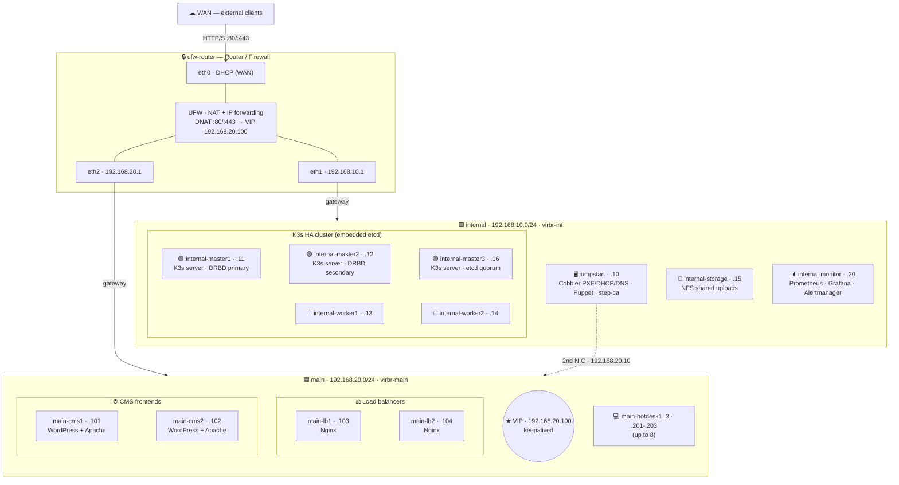
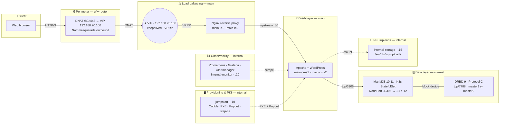

# Network Architecture Diagrams — CMS Infrastructure

This document contains the technical architecture diagrams for the CMS high-availability infrastructure, rendered with Mermaid.

---

## 1. Complete Network Topology

Physical and logical network segmentation: the two subnets, the router between them, every node with its address, and the jumpstart's second interface. The service flows between nodes are kept out of this diagram (they crossed each other) and are shown separately in [section 2](#2-service-architecture).

### Legend

| Symbol | Meaning |
|:-------|:--------|
| Solid line (`→` / `—`) | Subnet attachment / physical link |
| Dotted line (`-.->`) | Secondary (dual-homed) interface |
| Subnet label | `internal` / `main` — the network names used by `config.yaml` (`virbr-int` / `virbr-main`) |
| `🔒` | Router / firewall |
| `🖥` | Provisioning server (Cobbler · Puppet · step-ca) |
| `⚖` | Load balancer |
| `🟢` | K3s master node (DRBD) |
| `🔵` | K3s worker node |
| `💾` | Storage node (NFS server) |
| `📊` | Monitoring node (Prometheus · Grafana · alert rules) |
| `🌐` | CMS frontend (WordPress + Apache) |
| `💻` | Hot-desk workstation |

The `~~~` (invisible) links inside the cluster, load-balancer and frontend groups only keep each group laid out on one row; they carry no meaning.

---

## 2. Service Architecture

End-to-end traffic flow, from the external client to the database, plus the storage, observability and provisioning planes. Each balancer/frontend pair is collapsed into a single box (the individual nodes and addresses are in section 1).

### HTTP Traffic Flow

1. The **client** sends an HTTP/S request to the router's public IP.
2. The **router (UFW)** applies DNAT to redirect traffic on ports 80/443 to the keepalived **VIP** `192.168.20.100`, which is held by one of the two Nginx balancers (`main-lb1`/`main-lb2`).
3. **Nginx** distributes the request between `main-cms1` and `main-cms2` using round-robin.
4. The **Apache + WordPress** frontend processes the PHP request and queries **MariaDB** through the K3s **NodePort `30306`** on `internal-master1`/`internal-master2` (the frontend tries `.11` first and falls back to `.12`).
5. **DRBD** maintains synchronous replication of MariaDB data between `internal-master1` and `internal-master2`.
6. WordPress uploads live on the shared **NFS export** `internal-storage:/srv/nfs/wp-uploads`, mounted by both frontends, so either one can serve any request.

### Monitoring Flow

- **Prometheus** (192.168.10.20:9090) performs periodic scraping (every 15s) of all exporters and evaluates 19 alert rules (availability, service, backup/restore and HA — DRBD, etcd quorum, keepalived VIP). It scrapes `:9100` (node_exporter) on every node, `:9113` (nginx) on the balancers, `:9117` (Apache) on the frontends and `:9104` (mysqld) on the database.
- **Grafana** (192.168.10.20:3000) consumes Prometheus as a datasource and renders operational dashboards (node overview and HA overview).
- **Alertmanager** (192.168.10.20:9093) receives firing alerts from Prometheus and groups/deduplicates them for its UI and `amtool`; it ships with a no-op receiver, so add a webhook/email/Slack receiver to enable delivery.

---

## 3. Deployment Sequence

Diagram showing the execution order of deployment phases when running the solution.

### Deployment Sequence Notes

- `cms-ha deploy` runs this whole sequence in one shot; the individual `cms-ha phase …` commands shown above are the equivalent for re-running a single phase.
- The initial deployment requires launching the **Jumpstart node (Phase 00a)** first, as it serves as the provisioning server for all other clients.
- **Phase 00b** is performed **sequentially in batches** (`cms-ha vm install-batches`) to prevent the host's physical memory (27 GB) from being exhausted by the OS installers' initial requirements.
- The `cms-ha deploy --skip-vm-create` command orchestrates all phases from **Phase 01.8** onwards, once all client VMs are installed and running with optimised RAM.
- Configuration phases (Puppet, DRBD, K3s, Nginx, UFW, Monitoring, and Internal CA) are **strictly sequential** due to mutual service dependencies.
