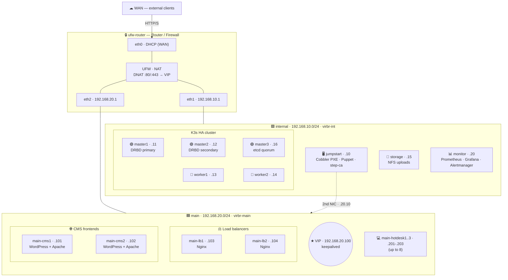

# Architecture Plan — CMS High-Availability Infrastructure

## Table of Contents

1. [Overview](#overview)
2. [Node Inventory](#node-inventory)
3. [Technology Stack](#technology-stack)
4. [Deployment Phases](#deployment-phases)
5. [Network Diagram](#network-diagram)
6. [Variables & Configuration](#variables--configuration)

---

## Overview

This project covers the **fully automated design, implementation, and provisioning** of a high-availability IT infrastructure for hosting a Content Management System (**CMS**).

### Key Design Decisions

| Aspect | Decision | Rationale |
|:-------|:---------|:----------|
| **CMS** | WordPress 6.x | Industry-leading CMS with the largest plugin ecosystem and well-understood requirements |
| **Database** | MariaDB 10.11.x | Community fork of MySQL with proven WordPress compatibility, LTS support, and superior performance |
| **Web Server (Frontends)** | Apache 2.4.x + PHP 8.3.x | Native WordPress compatibility (`.htaccess`, `mod_rewrite`), mature module ecosystem |
| **Load Balancer** | Nginx 1.24.x | High-performance reverse proxy with minimal resource footprint and upstream health checks |
| **Container Orchestrator** | K3s v1.29.x | Lightweight Kubernetes distribution, ideal for resource-constrained environments |
| **Block Replication** | DRBD 9.x | Synchronous Protocol C replication ensuring zero data loss between master nodes |
| **Bare-metal Provisioning** | Cobbler 3.3.x | PXE + autoinstall for fully unattended Ubuntu deployment across all nodes |
| **Configuration Management** | Puppet 8.x | Declarative, idempotent configuration with an agent/server model |
| **Observability** | Prometheus 2.x + Grafana 11.x | Industry-standard monitoring stack with exporters for every service layer |
| **Firewall** | UFW | iptables abstraction layer — auditable, scriptable, and easy to maintain |

The network is segmented into two subnets (`internal` and `main`) connected by a UFW router/firewall. The Jumpstart node (Cobbler + Puppet Server) has dual-homed presence in both networks to provision all nodes.

The entire deployment is executed from a **single entry point**: `./cms-ha deploy` (the legacy `deploy_all.sh` shell suite is deprecated and kept for reference only — see [`scripts/README.md`](../scripts/README.md)).

---

## Node Inventory

### Router / Firewall

| Hostname | IP | Network | Role | RAM | Disk | MAC |
|:---------|:---|:--------|:-----|:----|:-----|:----|
| ufw-router | eth0: DHCP (WAN) | WAN | Perimeter router / firewall | 768 MB | 5 GB | (auto) |
| | eth1: 192.168.10.1 | internal | Internal network gateway | | | (auto) |
| | eth2: 192.168.20.1 | main | `main` network gateway | | | (auto) |

### Jumpstart Node (dual/triple-homed)

| Hostname | IP | Network | Role | RAM | Disk | MAC |
|:---------|:---|:--------|:-----|:----|:-----|:----|
| jumpstart | 192.168.10.10 | internal | Cobbler + Puppet Server | 2048 MB | 30 GB | 52:54:00:10:00:01 |
| | 192.168.20.10 | main | (secondary interface) | | | 52:54:00:10:02:0a |
| | DHCP (WAN) | WAN | (optional interface for package downloads) | | | 52:54:00:10:00:09 |

### Internal Network — `internal` (192.168.10.0/24)

| Hostname | IP | Network | Role | RAM | Disk | MAC |
|:---------|:---|:--------|:-----|:----|:-----|:----|
| internal-master1 | 192.168.10.11 | internal | K3s Server (master), DRBD Primary | 1024 MB | 8 GB + 3 GB (DRBD) | 52:54:00:10:01:11 |
| internal-master2 | 192.168.10.12 | internal | K3s Server (master), DRBD Secondary | 1024 MB | 8 GB + 3 GB (DRBD) | 52:54:00:10:01:12 |
| internal-master3 | 192.168.10.16 | internal | K3s Server (master), etcd quorum (no DRBD) | 1024 MB | 8 GB | 52:54:00:10:01:16 |
| internal-worker1 | 192.168.10.13 | internal | K3s Agent (worker) | 768 MB | 8 GB | 52:54:00:10:01:13 |
| internal-worker2 | 192.168.10.14 | internal | K3s Agent (worker) | 768 MB | 8 GB | 52:54:00:10:01:14 |
| internal-storage | 192.168.10.15 | internal | Centralised NFS storage server (WordPress uploads) | 1024 MB | 8 GB | 52:54:00:10:01:15 |
| internal-monitor | 192.168.10.20 | internal | Prometheus + Grafana | 1024 MB | 10 GB | 52:54:00:10:01:10 |

### Main Network — `main` (192.168.20.0/24)

| Hostname | IP | Network | Role | RAM | Disk | MAC |
|:---------|:---|:--------|:-----|:----|:-----|:----|
| main-lb1 | 192.168.20.103 | main | Load balancer 1 (Nginx reverse proxy, keepalived MASTER) | 768 MB | 8 GB | 52:54:00:10:02:67 |
| main-lb2 | 192.168.20.104 | main | Load balancer 2 (Nginx reverse proxy, keepalived BACKUP) | 768 MB | 8 GB | 52:54:00:10:02:68 |
| *(VIP)* | 192.168.20.100 | main | Floating keepalived address (clients + router DNAT) | — | — | — |
| main-cms1 | 192.168.20.101 | main | CMS frontend (WordPress + Apache) | 1024 MB | 8 GB | 52:54:00:10:02:65 |
| main-cms2 | 192.168.20.102 | main | CMS frontend (WordPress + Apache) | 1024 MB | 8 GB | 52:54:00:10:02:66 |
| main-hotdesk1 | 192.168.20.201 | main | Hot-desk workstation (dynamic) | 768 MB | 10 GB | 52:54:00:10:02:c9 |
| main-hotdesk2 | 192.168.20.202 | main | Hot-desk workstation (dynamic) | 768 MB | 10 GB | 52:54:00:10:02:ca |
| main-hotdesk3 | 192.168.20.203 | main | Hot-desk workstation (dynamic) | 768 MB | 10 GB | 52:54:00:10:02:cb |
| ... | ... | ... | ... | ... | ... | ... |
| main-hotdesk8 | 192.168.20.208 | main | Hot-desk workstation (dynamic) | 768 MB | 10 GB | 52:54:00:10:02:d0 |

**Total:** 1 router + 1 jumpstart + 6 internal nodes + 4 fixed main nodes + N hot-desks (default 1 to 3, dynamically scalable up to 8).

---

## Technology Stack

| Technology | Version | Role in the Project |
|:-----------|:--------|:--------------------|
| **Go CLI (`cms-ha`)**| 1.22+ | Unified CLI orchestrator, connection pooling & concurrency manager |
| **Cobbler** | 3.3.x | Zero-touch bare-metal provisioning (PXE + autoinstall) |
| **Puppet** | 8.x | Idempotent configuration management (server + agents) |
| **Nginx** | 1.24.x | Reverse proxy load balancing with health checks |
| **K3s** | v1.29.x | Lightweight Kubernetes HA clustering |
| **MariaDB** | 10.11.x | SQL database for WordPress (Kubernetes StatefulSet) |
| **WordPress** | 6.x | Content Management System (CMS) |
| **Apache** | 2.4.x | Web server for CMS frontends |
| **Prometheus** | 2.x | Infrastructure and service metrics collection |
| **Grafana** | 11.x | Metrics visualisation and operational dashboards |
| **UFW** | — | Network segmentation and per-node firewalling |
| **DRBD** | 9.x | High availability — synchronous block-level replication |

---

## Project Phases & Deployment Mapping

The project structure is split between the **Project Milestones** (which correspond to the design phases documented in `docs/phases/PHASE-XX-descriptive-name.md`) and the **Technical Execution Sequence** implemented by the Go orchestrator (`cms-ha deploy`).

### 1. Project Milestones (Design Phases)

| Phase | Project Milestone | Key Task | Documentation |
|:---:|:---|:---|:---|
| **00** | Network Design and Addressing | IP & MAC planning, VM specifications | [Phase 00](phases/PHASE-00-network-design.md) |
| **01** | Jumpstart Node / Cobbler | Cobbler PXE server setup & autoinstall profiles | [Phase 01](phases/PHASE-01-cobbler-provisioning.md) |
| **02** | Network Redundancy | L2 Loop prevention with Spanning Tree (STP) | [Phase 02](phases/PHASE-02-network-redundancy.md) |
| **03** | HA Cluster and Database | DRBD block replication & K3s cluster database | [Phase 03](phases/PHASE-03-ha-cluster-database.md) |
| **04** | Routing and L3 Hardening | Perimeter routing (UFW router) & NAT policies | [Phase 04](phases/PHASE-04-routing-security.md) |
| **05** | CMS Frontends and Load Balancer | Nginx Load Balancer & Apache CMS frontends | [Phase 05](phases/PHASE-05-cms-loadbalancer.md) |
| **06** | Nodal Firewalling (End-point Security) | Local firewall rules per node via UFW | [Phase 06](phases/PHASE-06-node-firewalling.md) |
| **07** | Infrastructure Monitoring | Prometheus & node_exporter metrics scraping | [Phase 07](phases/PHASE-07-infra-monitoring.md) |
| **08** | Service Monitoring | Nginx, Apache, MariaDB exporters & Grafana | [Phase 08](phases/PHASE-08-service-monitoring.md) |
| **09** | Hot-desk Workstations | Automated workstation VM provisioning | [Phase 09](phases/PHASE-09-hotdesk-workstations.md) |
| **10** | TrafficMix and End-to-End Tests | Automated load testing & verification checks | [Phase 10](phases/PHASE-10-traffic-testing.md) |
| **11** | Final Documentation | Project manuals, baseline & diagram validation | [Phase 11](phases/PHASE-11-final-documentation.md) |

### 2. Dual Technical Execution Sequence

The deployment is executed end-to-end by the Go CLI (`cms-ha deploy`); the **Bash Script (v1)** column is the deprecated equivalent, kept for reference only (see [`scripts/README.md`](../scripts/README.md)). The dependency ordering is identical:

| Phase | Go CLI (v2) | Bash Script (v1) | Description | Milestone Mapping |
|:---:|:---|:---|:---|:---:|
| **00a** | `cms-ha phase init-vms --jumpstart-only` | `00_init_vms.sh --jumpstart-only` | Virtual networks creation and Jumpstart node provisioning | Phase 00 |
| **01** | `cms-ha phase setup-cobbler` | `01_setup_cobbler.sh` | Cobbler configuration (PXE, DHCP, TFTP, DNS) on Jumpstart | Phase 01 |
| **01.5**| `cms-ha phase register-nodes` | `02_register_cobbler_nodes.sh` | Registration of all target nodes and MAC bindings in Cobbler | Phase 01 |
| **00b** | `cms-ha vm install-batches` | `00_init_vms.sh --nodes-only` | Unattended PXE installation of all client nodes | Phase 00 |
| **01.8**| `cms-ha phase repair-ssh` | `03_repair_ssh_puppet.sh` | Post-install SSH key sync & Puppet CA certificate repair | Phase 01 |
| **02** | `cms-ha phase setup-puppet` | `04_setup_puppet.sh` | Parallel Puppet catalog execution (worker pool) | Phase 01, Phase 09 |
| **03** | `cms-ha phase setup-drbd` | `05_setup_drbd.sh` | DRBD HA block storage replication setup on master nodes | Phase 03 |
| **03.5** | `cms-ha phase setup-backup` | *(new, no legacy script)* | Off-DRBD Garage S3 backup store on the hypervisor (container) | Phase 03 |
| **04** | `cms-ha phase setup-kubernetes` | `06_setup_kubernetes.sh` | K3s HA clustering & MariaDB deployment on DRBD storage | Phase 03 |
| **05** | `cms-ha phase setup-nginx-wordpress` | `07_setup_nginx_wordpress.sh` | Nginx Load Balancer, NFS shared storage & WordPress frontends | Phase 05 |
| **06** | `cms-ha phase setup-monitoring` | `08_setup_monitoring.sh` | Prometheus monitoring, exporters, Grafana & alerts | Phase 07, Phase 08 |
| **07** | `cms-ha phase setup-ufw` | `09_setup_ufw.sh` | Perimeter routing (router) & per-node firewall policies | Phase 04, Phase 06 |
| **08** | `cms-ha phase setup-ca` | `10_setup_internal_ca.sh` | Step-CA PKI deployment, TLS cert issuance and trust sync | Phase 04 |
| **09** | `cms-ha traffic` | `11_traffic_mix.sh` | HTTP traffic generation & end-to-end load testing | Phase 10 |

---

## Network Diagram

> The two subnet names are **`internal`** (`virbr-int`) and **`main`** (`virbr-main`). `jumpstart` lives on `internal` and is dual-homed on `main` (`192.168.20.10`).
>
> For the detailed topology, service architecture, and deployment sequence diagrams see [`NETWORK_DIAGRAM.md`](NETWORK_DIAGRAM.md).

---

## Variables and Configuration

Configurable parameters used throughout the deployment scripts:

### Network Addressing

| Variable | Value | Description |
|:---------|:------|:------------|
| `INTERNAL_NET` | `192.168.10.0/24` | `internal` network CIDR (bridge `virbr-int`) |
| `MAIN_NET` | `192.168.20.0/24` | `main` network CIDR (bridge `virbr-main`) |
| `GW_INTERNAL` | `192.168.10.1` | `internal` gateway (router eth1) |
| `GW_MAIN` | `192.168.20.1` | `main` gateway (router eth2) |
| `DNS_SERVER` | `192.168.10.10` | DNS server (BIND9/Cobbler on jumpstart, `internal`) |
| `JUMPSTART_IP_MAIN` | `192.168.20.10` | Jumpstart's second interface on `main` |

In the v2 Go CLI these values come from `config.yaml` (`network.internal` / `network.main`); the variable names above are those used by the deprecated Bash scripts.

### Core Nodes

| Variable | Value | Description |
|:---------|:------|:------------|
| `JUMPSTART_IP` | `192.168.10.10` | Jumpstart node (Cobbler + Puppet) |
| `MASTER1_IP` | `192.168.10.11` | First K3s master node (DRBD Primary) |
| `MASTER2_IP` | `192.168.10.12` | Second K3s master node (DRBD Secondary) |
| `MASTER3_IP` | `192.168.10.16` | Third K3s server (etcd quorum, no DRBD) |
| `WORKER1_IP` | `192.168.10.13` | First K3s worker node |
| `WORKER2_IP` | `192.168.10.14` | Second K3s worker node |
| `STORAGE_IP` | `192.168.10.15` | Storage node |
| `MONITOR_IP` | `192.168.10.20` | Monitoring node (Prometheus + Grafana) |
| `LB1_IP` | `192.168.20.103` | Nginx load balancer 1 (keepalived MASTER) |
| `LB2_IP` | `192.168.20.104` | Nginx load balancer 2 (keepalived BACKUP) |
| `LB_VIP` | `192.168.20.100` | Floating keepalived VIP (clients + router DNAT target) |
| `CMS1_IP` | `192.168.20.101` | CMS frontend 1 |
| `CMS2_IP` | `192.168.20.102` | CMS frontend 2 |
| `ROUTER_IP` | `192.168.10.1` | Router internal interface |

### Services

| Variable | Value | Description |
|:---------|:------|:------------|
| `CMS_DOMAIN` | `cms.fake-enterprise.com` | CMS domain (resolved by internal DNS) |
| `GRAFANA_PORT` | `3000` | Grafana dashboard port |
| `PROMETHEUS_PORT` | `9090` | Prometheus API port |
| `NODE_EXPORTER_PORT` | `9100` | node_exporter port on each node |
| `DRBD_PORT` | `7788` | DRBD synchronisation port |
| `K3S_API_PORT` | `6443` | Kubernetes API server port |
| `MARIADB_PORT` | `30306` | MariaDB NodePort (in-cluster service listens on 3306) |

### Virtualisation

| Variable | Value | Description |
|:---------|:------|:------------|
| `VM_DIR` | `$HOME/vm_storage` | VM disk image storage directory |
| `OS_VARIANT` | `ubuntu24.04` | OS variant for `virt-install` |
