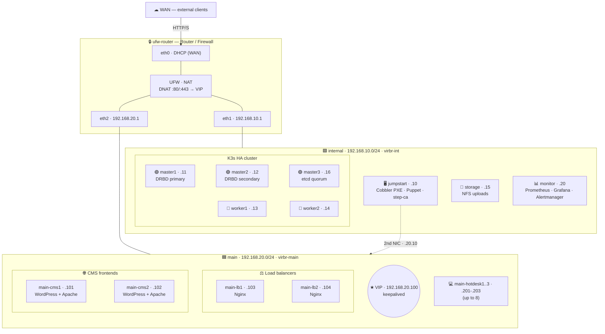

# Architecture Plan — CMS High-Availability Infrastructure

## Table of Contents

1. [Overview](#overview)
2. [Node Inventory](#node-inventory)
3. [Technology Stack](#technology-stack)
4. [Deployment Phases](#deployment-phases)
5. [Network Diagram](#network-diagram)
6. [Addressing Reference](#addressing-reference)

---

## Overview

This project covers the **fully automated design, implementation, and provisioning** of a high-availability IT infrastructure for hosting a Content Management System (**CMS**).

### Key Design Decisions

| Aspect | Decision | Rationale |
|:-------|:---------|:----------|
| **CMS** | WordPress 6.x | Industry-leading CMS with the largest plugin ecosystem and well-understood requirements |
| **Database** | MariaDB 10.11.x | Community fork of MySQL with proven WordPress compatibility, LTS support, and superior performance |
| **Web Server (Frontends)** | Apache 2.4.x + PHP 8.3.x | Native WordPress compatibility (`.htaccess`, `mod_rewrite`), mature module ecosystem |
| **Load Balancer** | Nginx 1.24.x | High-performance reverse proxy with minimal resource footprint and upstream health checks |
| **Container Orchestrator** | K3s v1.29.x | Lightweight Kubernetes distribution, ideal for resource-constrained environments |
| **Block Replication** | DRBD 9.x | Synchronous Protocol C replication ensuring zero data loss between master nodes |
| **Bare-metal Provisioning** | Cobbler 3.3.x | PXE + autoinstall for fully unattended Ubuntu deployment across all nodes |
| **Configuration Management** | Puppet 8.x | Declarative, idempotent configuration with an agent/server model |
| **Observability** | Prometheus 2.x + Grafana 13.2.4 | Industry-standard monitoring stack with exporters for every service layer |
| **Firewall** | UFW | iptables abstraction layer — auditable, scriptable, and easy to maintain |

The network is segmented into two subnets (`internal` and `main`) connected by a UFW router/firewall. The Jumpstart node (Cobbler + Puppet Server) has dual-homed presence in both networks to provision all nodes.

The entire deployment is executed from a **single entry point**: `./cms-ha deploy`.

---

## Node Inventory

### Router / Firewall

| Hostname | IP | Network | Role | RAM | Disk | MAC |
|:---------|:---|:--------|:-----|:----|:-----|:----|
| ufw-router | eth0: DHCP (WAN) | WAN | Perimeter router / firewall | 768 MB | 5 GB | (auto) |
| | eth1: 192.168.10.1 | internal | Internal network gateway | | | (auto) |
| | eth2: 192.168.20.1 | main | `main` network gateway | | | (auto) |

### Jumpstart Node (dual/triple-homed)

| Hostname | IP | Network | Role | RAM | Disk | MAC |
|:---------|:---|:--------|:-----|:----|:-----|:----|
| jumpstart | 192.168.10.10 | internal | Cobbler + Puppet Server | 2048 MB | 30 GB | 52:54:00:10:00:01 |
| | 192.168.20.10 | main | (secondary interface) | | | 52:54:00:10:02:0a |
| | DHCP (WAN) | WAN | (optional interface for package downloads) | | | 52:54:00:10:00:09 |

### Internal Network — `internal` (192.168.10.0/24)

| Hostname | IP | Network | Role | RAM | Disk | MAC |
|:---------|:---|:--------|:-----|:----|:-----|:----|
| internal-master1 | 192.168.10.11 | internal | K3s Server (master), DRBD Primary | 1024 MB | 8 GB + 3 GB (DRBD) | 52:54:00:10:01:11 |
| internal-master2 | 192.168.10.12 | internal | K3s Server (master), DRBD Secondary | 1024 MB | 8 GB + 3 GB (DRBD) | 52:54:00:10:01:12 |
| internal-master3 | 192.168.10.16 | internal | K3s Server (master), etcd quorum (no DRBD) | 1024 MB | 8 GB | 52:54:00:10:01:16 |
| internal-worker1 | 192.168.10.13 | internal | K3s Agent (worker) | 768 MB | 8 GB | 52:54:00:10:01:13 |
| internal-worker2 | 192.168.10.14 | internal | K3s Agent (worker) | 768 MB | 8 GB | 52:54:00:10:01:14 |
| internal-storage | 192.168.10.15 | internal | Centralised NFS storage server (WordPress uploads) | 1024 MB | 8 GB | 52:54:00:10:01:15 |
| internal-monitor | 192.168.10.20 | internal | Prometheus + Grafana | 1024 MB | 10 GB | 52:54:00:10:01:10 |

### Main Network — `main` (192.168.20.0/24)

| Hostname | IP | Network | Role | RAM | Disk | MAC |
|:---------|:---|:--------|:-----|:----|:-----|:----|
| main-lb1 | 192.168.20.103 | main | Load balancer 1 (Nginx reverse proxy, keepalived MASTER) | 768 MB | 8 GB | 52:54:00:10:02:67 |
| main-lb2 | 192.168.20.104 | main | Load balancer 2 (Nginx reverse proxy, keepalived BACKUP) | 768 MB | 8 GB | 52:54:00:10:02:68 |
| *(VIP)* | 192.168.20.100 | main | Floating keepalived address (clients + router DNAT) | — | — | — |
| main-cms1 | 192.168.20.101 | main | CMS frontend (WordPress + Apache) | 1024 MB | 8 GB | 52:54:00:10:02:65 |
| main-cms2 | 192.168.20.102 | main | CMS frontend (WordPress + Apache) | 1024 MB | 8 GB | 52:54:00:10:02:66 |
| main-hotdesk1 | 192.168.20.201 | main | Hot-desk workstation (dynamic) | 768 MB | 10 GB | 52:54:00:10:02:c9 |
| main-hotdesk2 | 192.168.20.202 | main | Hot-desk workstation (dynamic) | 768 MB | 10 GB | 52:54:00:10:02:ca |
| main-hotdesk3 | 192.168.20.203 | main | Hot-desk workstation (dynamic) | 768 MB | 10 GB | 52:54:00:10:02:cb |
| ... | ... | ... | ... | ... | ... | ... |
| main-hotdesk8 | 192.168.20.208 | main | Hot-desk workstation (dynamic) | 768 MB | 10 GB | 52:54:00:10:02:d0 |

**Total:** 1 router + 1 jumpstart + 7 internal nodes + 4 fixed main nodes + N hot-desks (default 3, scalable up to 8).

---

## Technology Stack

| Technology | Version | Role in the Project |
|:-----------|:--------|:--------------------|
| **Go CLI (`cms-ha`)**| 1.26+ | Unified CLI orchestrator, connection pooling & concurrency manager |
| **Cobbler** | 3.3.x | Zero-touch bare-metal provisioning (PXE + autoinstall) |
| **Puppet** | 8.x | Idempotent configuration management (server + agents) |
| **Nginx** | 1.24.x | Reverse proxy load balancing with health checks |
| **K3s** | v1.29.x | Lightweight Kubernetes HA clustering |
| **MariaDB** | 10.11.x | SQL database for WordPress (Kubernetes StatefulSet) |
| **WordPress** | 6.x | Content Management System (CMS) |
| **Apache** | 2.4.x | Web server for CMS frontends |
| **Prometheus** | 2.x | Infrastructure and service metrics collection |
| **Grafana** | 13.2.4 | Metrics visualisation and operational dashboards |
| **UFW** | — | Network segmentation and per-node firewalling |
| **DRBD** | 9.x | High availability — synchronous block-level replication |

---

## Project Phases & Deployment Mapping

The project structure is split between the **Project Milestones** (which correspond to the design phases documented in `docs/phases/PHASE-XX-descriptive-name.md`) and the **Technical Execution Sequence** implemented by the Go orchestrator (`cms-ha deploy`).

### 1. Project Milestones (Design Phases)

| Phase | Project Milestone | Key Task | Documentation |
|:---:|:---|:---|:---|
| **00** | Network Design and Addressing | IP & MAC planning, VM specifications | [Phase 00](phases/PHASE-00-network-design.md) |
| **01** | Jumpstart Node / Cobbler | Cobbler PXE server setup & autoinstall profiles | [Phase 01](phases/PHASE-01-cobbler-provisioning.md) |
| **02** | Network Redundancy | L2 Loop prevention with Spanning Tree (STP) | [Phase 02](phases/PHASE-02-network-redundancy.md) |
| **03** | HA Cluster and Database | DRBD block replication & K3s cluster database | [Phase 03](phases/PHASE-03-ha-cluster-database.md) |
| **04** | Routing and L3 Hardening | Perimeter routing (UFW router) & NAT policies | [Phase 04](phases/PHASE-04-routing-security.md) |
| **05** | CMS Frontends and Load Balancer | Nginx Load Balancer & Apache CMS frontends | [Phase 05](phases/PHASE-05-cms-loadbalancer.md) |
| **06** | Nodal Firewalling (End-point Security) | Local firewall rules per node via UFW | [Phase 06](phases/PHASE-06-node-firewalling.md) |
| **07** | Infrastructure Monitoring | Prometheus & node_exporter metrics scraping | [Phase 07](phases/PHASE-07-infra-monitoring.md) |
| **08** | Service Monitoring | Nginx, Apache, MariaDB exporters & Grafana | [Phase 08](phases/PHASE-08-service-monitoring.md) |
| **09** | Hot-desk Workstations | Automated workstation VM provisioning | [Phase 09](phases/PHASE-09-hotdesk-workstations.md) |
| **10** | Traffic, End-to-End Tests and Jumpstart Shutdown | k6 load profile, functional checks, survival test | [Phase 10](phases/PHASE-10-traffic-testing.md) |
| **11** | Final Documentation | Project manuals, baseline & diagram validation | [Phase 11](phases/PHASE-11-final-documentation.md) |

### 2. Technical Execution Sequence

The deployment is executed end-to-end by the Go CLI (`cms-ha deploy`):

| Step | Command | Description | Milestone |
|:---:|:--------|:------------|:---:|
| 1 | `cms-ha phase init-vms --jumpstart-only` | Networks and jumpstart VM | Phase 00 |
| 2 | `cms-ha phase setup-cobbler` | Cobbler (PXE, DHCP, TFTP, DNS) on jumpstart | Phase 01 |
| 3 | `cms-ha phase register-nodes` | Node, MAC and static IP registration | Phase 01 |
| 4 | `cms-ha vm install-batches` | Unattended PXE installation of the clients | Phase 00 |
| 5 | `cms-ha phase repair-ssh` | SSH key sync and Puppet CA repair | Phase 01 |
| 6 | `cms-ha phase bootstrap-router` | Gateway addresses, IP forwarding and NAT | Phase 04, 06 |
| 7 | `cms-ha phase setup-puppet` | Parallel Puppet convergence of every node | Phase 01, 09 |
| 8 | `cms-ha phase setup-drbd` | DRBD replication on the masters | Phase 03 |
| 9 | `cms-ha phase setup-backup` | Garage S3 backup store on the hypervisor | Phase 03 |
| 10 | `cms-ha phase setup-kubernetes` | K3s cluster and MariaDB on DRBD | Phase 03 |
| 11 | `cms-ha phase setup-nginx-wordpress` | Nginx, keepalived, NFS and WordPress | Phase 05 |
| 12 | `cms-ha phase setup-monitoring` | Prometheus, Grafana and alert rules | Phase 07, 08 |
| 13 | `cms-ha phase setup-ufw` | Perimeter and per-node firewall | Phase 04, 06 |
| 14 | `cms-ha phase setup-ca` | step-ca PKI and cluster-wide TLS trust | Phase 04 |

---

## Network Diagram

> The two subnet names are **`internal`** (`virbr-int`) and **`main`** (`virbr-main`). `jumpstart` lives on `internal` and is dual-homed on `main` (`192.168.20.10`).
>
> For the detailed topology, service architecture, and deployment sequence diagrams see [`NETWORK_DIAGRAM.md`](NETWORK_DIAGRAM.md).

---

## Addressing Reference

The lab addresses below come from `config.yaml` (`network` and `nodes`), the
single source of truth.

### Networks

| Item | Value | Description |
|:-----|:------|:------------|
| `internal` CIDR | `192.168.10.0/24` | K3s, storage and monitoring (bridge `virbr-int`) |
| `main` CIDR | `192.168.20.0/24` | Load balancers, CMS frontends and hot-desks (bridge `virbr-main`) |
| `internal` gateway | `192.168.10.1` | Router `eth1` |
| `main` gateway | `192.168.20.1` | Router `eth2` |
| DNS server | `192.168.10.10` | BIND9/Cobbler on jumpstart |
| Jumpstart (`main`) | `192.168.20.10` | Second jumpstart interface |

### Nodes

| Item | Value | Description |
|:-----|:------|:------------|
| jumpstart | `192.168.10.10` | Cobbler + Puppet Server + CA |
| master1 | `192.168.10.11` | K3s server + DRBD Primary |
| master2 | `192.168.10.12` | K3s server + DRBD Secondary |
| master3 | `192.168.10.16` | K3s server (etcd quorum, no DRBD) |
| worker1 | `192.168.10.13` | K3s worker |
| worker2 | `192.168.10.14` | K3s worker |
| storage | `192.168.10.15` | NFS uploads |
| monitor | `192.168.10.20` | Prometheus + Grafana + Alertmanager |
| lb1 | `192.168.20.103` | Nginx (keepalived MASTER) |
| lb2 | `192.168.20.104` | Nginx (keepalived BACKUP) |
| VIP | `192.168.20.100` | Floating keepalived address (DNAT target) |
| cms1 | `192.168.20.101` | WordPress + Apache |
| cms2 | `192.168.20.102` | WordPress + Apache |
| router | `192.168.10.1` | Internal router interface |

### Services

| Item | Value | Description |
|:-----|:------|:------------|
| CMS domain | `cms.fake-enterprise.com` | Resolved by internal DNS |
| Grafana | `3000` | Dashboard port |
| Prometheus | `9090` | API port |
| node_exporter | `9100` | Metrics port on each node |
| DRBD | `7788` | Replication port |
| K3s API | `6443` | Kubernetes API port |
| MariaDB | `30306` | NodePort (the service listens on 3306) |

### Virtualisation

| Item | Value | Description |
|:-----|:------|:------------|
| VM storage | `$HOME/vm_storage` | Disk image directory |
| OS variant | `ubuntu24.04` | `virt-install` variant |
